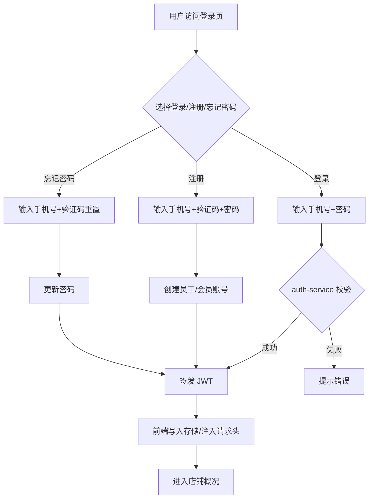
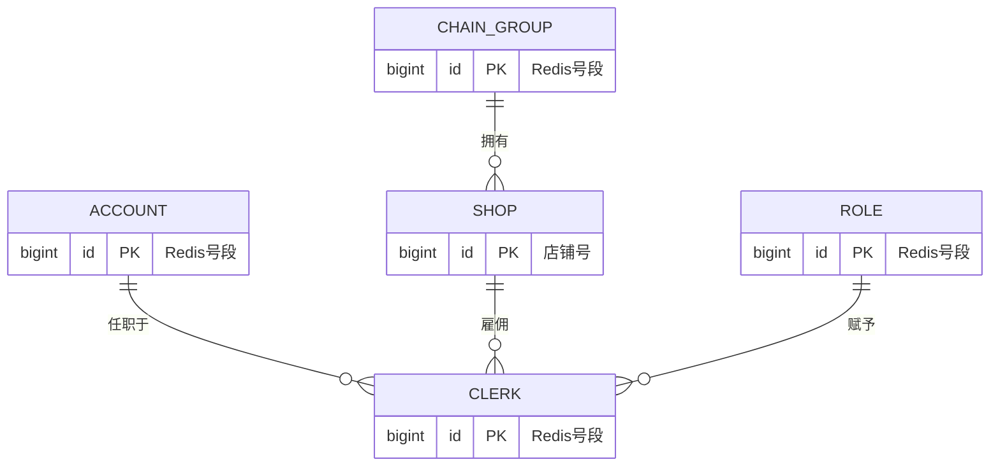

# 功能开发文档 · 01·登录鉴权

> 项目：宠老板复刻 · 模块：auth-service · 里程碑：M1（P0）
> 开发范式说明：本文档为**功能开发样板**，含 O 标准七段式结构，后续每个功能均按此模板编写。

---

## 1. 功能概述

本次实现**手机号+密码登录、注册、忘记密码、JWT 签发**，打通前端登录页与后端 `auth-service`，建立租户（店铺）上下文与多语言(zh-cn)基础。

- 面向角色：登录用户（超级管理员/员工，支持`+86`手机号与密码）
- 核心产出：登录态签发（JWT）、登录请求上下文（shop_id / chain_group_id）、前端路由守卫
- 依赖前置：M0 脚手架（Nacos / MySQL / Redis / 公共组件）

---

## 2. 业务流程图



---

## 3. 需求明细（验收点）

| 编号 | 功能点 | 说明 | 优先级 |
|------|--------|------|--------|
| R-01 | 手机号+密码登录 | `+86` 手机号 + 密码，记住密码 | P0 |
| R-02 | 注册 | 手机号 + 短信验证码 + 密码，创建账号 | P0 |
| R-03 | 忘记密码 | 手机号 + 验证码重置密码 | P0 |
| R-04 | JWT 签发 | 登录成功下发 JWT，携带 tenant 上下文 | P0 |
| R-05 | 路由守卫 | 未登录跳转登录页，已登录拦截重进 | P0 |
| R-06 | 多语言 | zh-cn 语言包切换 | P1 |

---

## 4. 表结构设计

> **设计原则**：登录账号（人）与雇佣关系（岗位）分离，支撑一人多集团任职、离职再入职。MySQL 存核心实体（事务型），MongoDB 存高吞吐日志（sms_code / login_log），Redis 扛实时校验。

### 4.1 存储分布

| 存储 | 表/集合 | 用途 |
|------|---------|------|
| MySQL | `chain_group` / `shop` / `account` / `clerk` / `role` | 核心实体 |
| MongoDB | `sms_code` / `login_log` | 审计留痕，TTL 自动过期 |
| Redis | 号段 / sms 校验 / 缓存 | 实时数据 |

### 4.2 MySQL 表

#### 4.2.1 `account` — 登录账号表（人维度）
| 字段 | 类型 | 约束 | 说明 |
|------|------|------|------|
| id | bigint | PK | Redis 号段 |
| phone | varchar(20) | UNIQUE | 登录手机号（全局唯一） |
| password | varchar(100) | NOT NULL | BCrypt 密文 |
| truename | varchar(50) | | 真实姓名 |
| status | tinyint | DEFAULT 1 | 0 禁用 1 启用 |
| version | int | DEFAULT 0 | 乐观锁 |
| create_time / update_time | datetime | | 审计 |

#### 4.2.2 `clerk` — 员工雇佣关系表（岗位维度）
| 字段 | 类型 | 约束 | 说明 |
|------|------|------|------|
| id | bigint | PK | Redis 号段 |
| account_id | bigint | NOT NULL | 关联账号 |
| shop_id | bigint | NOT NULL | 所属店铺 |
| chain_group_id | bigint | NOT NULL | 所属集团（冗余） |
| role_id | bigint | NOT NULL | 角色 |
| is_super | tinyint | DEFAULT 0 | 是否该店超级管理员 |
| status | tinyint | DEFAULT 1 | 0 离职 1 在职 |
| hire_date | date | | 入职日期 |
| leave_date | date | | 离职日期 |
| version | int | DEFAULT 0 | 乐观锁 |
| create_time / update_time | datetime | | 审计 |

> 复合唯一索引 `(account_id, shop_id, status)` — 同一人同一店仅一条在职记录，离职后再入职新建记录。

#### 4.2.3 `chain_group` — 连锁集团表
| 字段 | 类型 | 约束 | 说明 |
|------|------|------|------|
| id | bigint | PK | Redis 号段 |
| group_name | varchar(100) | NOT NULL | 集团名称 |
| contact_name | varchar(50) | | 联系人 |
| contact_phone | varchar(20) | | 联系电话 |
| status | tinyint | DEFAULT 1 | 0 禁用 1 启用 |
| version | int | DEFAULT 0 | 乐观锁 |
| create_time / update_time | datetime | | 审计 |

#### 4.2.4 `shop` — 店铺表（复用）
| 字段 | 类型 | 约束 | 说明 |
|------|------|------|------|
| id | bigint | PK | 店铺号 shop_id |
| chain_group_id | bigint | NOT NULL | 所属集团 |
| shop_name | varchar(100) | NOT NULL | 店铺名称 |
| level | int | DEFAULT 1 | 版本等级 |
| expire_time | datetime | | 到期时间 |
| status | tinyint | DEFAULT 1 | 0 禁用 1 启用 |
| version | int | DEFAULT 0 | 乐观锁 |
| create_time / update_time | datetime | | 审计 |

#### 4.2.5 `role` — 角色表
| 字段 | 类型 | 约束 | 说明 |
|------|------|------|------|
| id | bigint | PK | Redis 号段 |
| shop_id | bigint | DEFAULT 0 | 所属店铺（0=系统内置） |
| role_name | varchar(50) | NOT NULL | 角色名称 |
| role_code | varchar(50) | NOT NULL | 角色编码 |
| is_system | tinyint | DEFAULT 0 | 是否系统内置 |
| status | tinyint | DEFAULT 1 | 0 禁用 1 启用 |
| version | int | DEFAULT 0 | 乐观锁 |
| create_time / update_time | datetime | | 审计 |

### 4.3 MongoDB 集合

#### 4.3.1 `sms_code` — 短信验证码留痕
```json
{ "phone":"15638538859", "biz_type":"register", "code_hash":"$2a$10$...",
  "ip":"192.168.1.100", "expire_at":ISODate, "used":false, "used_at":null,
  "create_time":ISODate }
```
- 索引：`{ phone:1, biz_type:1, create_time:-1 }` / TTL `{ expire_at:1 }` 5 分钟自动删除
- 实时校验走 Redis（`sms:code:{biz_type}:{phone}`，TTL 300s），MongoDB 仅留痕

#### 4.3.2 `login_log` — 登录日志
```json
{ "account_id":NumberLong, "clerk_id":NumberLong, "shop_id":NumberLong,
  "phone":"15638538859", "login_status":1, "fail_reason":null,
  "ip":"192.168.1.100", "user_agent":"Mozilla/5.0...", "create_time":ISODate }
```
- 索引：`{ phone:1, create_time:-1 }` / `{ account_id:1, create_time:-1 }` / TTL `{ create_time:1 }` 90 天自动删除

### 4.4 ER 关系图



### 4.5 建表脚本

| 脚本 | 路径 | 说明 |
|------|------|------|
| MySQL DDL | `scripts/mysql/01-auth-ddl.sql` | 5 张表建表语句 |
| 种子数据 | `scripts/mysql/02-auth-seed.sql` | 集团/店铺/角色/账号/雇佣关系 |
| MongoDB 初始化 | `scripts/mongodb/01-auth-init.js` | 集合 + TTL 索引 |

---

## 5. 后端接口设计（RESTful）

### 5.1 POST /api/v1/auth/login
```json
// 请求
{ "phone":"15638538859", "password":"******", "remember":true, "lang":"zh-cn" }
// 响应 A：仅一个在职岗位，直接签发
{ "code":0, "msg":"成功",
  "data":{ "token":"eyJ...", "shop_id":80351, "role_name":"超级管理员" } }
// 响应 B：多个在职岗位，需选店
{ "code":0, "msg":"成功",
  "data":{
    "need_select":true,
    "shops":[
      { "clerk_id":20001, "shop_id":80351, "shop_name":"示例宠物店A", "role_name":"超级管理员" },
      { "clerk_id":20002, "shop_id":80400, "shop_name":"示例宠物店B", "role_name":"店员" }
    ]}}
```
- 校验：手机号格式 → `account` 密码 BCrypt 比对 → 查在职 `clerk` 列表 → 单岗位直接签发 / 多岗位返回选店列表。
- JWT payload：`sub`(account_id)、`clerk_id`、`shop_id`、`chain_group_id`、`role_id`、`exp`。
- 记住密码：`remember=true` 时前端持久化账号。

### 5.2 POST /api/v1/auth/select-shop
```json
// 请求
{ "clerk_id":20001 }
// 响应
{ "code":0, "data":{ "token":"eyJ...", "shop_id":80351, "role_name":"超级管理员" } }
```
- 多岗位场景下用户选店后签发 JWT。

### 5.3 POST /api/v1/auth/register
- 入参：`phone`、`code`(短信验证码)、`password`。校验码后创建 `account` 并签发 JWT。

### 5.4 POST /api/v1/auth/reset-password
- 入参：`phone`、`code`、`newPassword`。更新 `account.password`。

### 5.5 公共约定
- 请求头：`Authorization: Bearer {jwt}`。
- 响应统一：`{ code, msg, data, page? }`，`code=0` 成功。
- 租户上下文：网关解析 JWT 并注入 `X-Shop-Id`、`X-Chain-Group-Id` 头，服务端 `AuthContextHolder` 读取。

---

## 6. 前端页面设计（React + Antd 5）

- 路由：`/login`（公开），其余受 `AuthGuard` 守卫。
- 登录页：`Login.tsx`——手机号/密码/记住密码/切换注册与忘记密码表单。
- 状态管理：Zustand `authStore`（token、shopInfo、persist）。
- 请求拦截：Axios 拦截器统一挂 `Authorization` 头与 `lang`；401 时清除态并跳登录。

---

## 7. 代码结构落点

```
auth-service/
  src/main/java/com/pets/auth/
    controller/AuthController.java
    service/AuthService.java
    service.impl/AuthServiceImpl.java
    dto/LoginReq.java / RegisterReq.java / ResetPasswordReq.java / SelectShopReq.java
    context/AuthContextHolder.java
    util/JwtUtil.java
    mapper/AccountMapper.java / ClerkMapper.java
    entity/Account.java / Clerk.java / Role.java / Shop.java / ChainGroup.java
    mongo/SmsCodeDoc.java / LoginLogDoc.java
frontend/
  src/router/index.tsx        (AuthGuard)
  src/pages/login/Login.tsx / SelectShop.tsx
  src/api/auth.ts
  src/store/authStore.ts
scripts/
  mysql/01-auth-ddl.sql       (建表)
  mysql/02-auth-seed.sql       (种子数据)
  mongodb/01-auth-init.js      (集合+索引)
```

---

## 8. 开发任务清单（供开发者照单执行）

- [ ] 建表：执行 `scripts/mysql/01-auth-ddl.sql` + `02-auth-seed.sql`；执行 `scripts/mongodb/01-auth-init.js`；写入 Redis 号段初始化。
- [ ] `auth-service`：`JwtUtil` 生成/解析，`AuthController` 四个端点（login / select-shop / register / reset-password）。
- [ ] `auth-service`：MongoDB 双写 `SmsCodeDoc` / `LoginLogDoc`（Redis 实时校验 + MongoDB 留痕）。
- [ ] 前端：`Login.tsx` + `SelectShop.tsx` + `authStore` + Axios 拦截器 + `AuthGuard`。
- [ ] 网关：JWT 校验过滤器 + 白名单(`/login`、`/register`、`/select-shop`) + 租户头透传。
- [ ] 自测：登录成功/密码错误/多店选择/未授权访问，附 curl 或 Postman 用例。
- [ ] 联调：前端登录 → 选店（多岗位时）→ 进入店铺概况。

---

## 9. 验收标准（Definition of Done）

- [ ] 正确手机号+密码可登录并拿到 JWT 与 shop 上下文。
- [ ] 多岗位登录可返回选店列表，选店后正确签发 JWT。
- [ ] 离职账号（无在职 clerk）登录提示无有效岗位。
- [ ] 错误密码返回明确提示，无明文泄露。
- [ ] 未带/过期 token 请求被网关拦截返回 401。
- [ ] 短信验证码 Redis 校验 + MongoDB 留痕双写正常。
- [ ] 登录日志写入 MongoDB，TTL 索引可自动过期。
- [ ] 前端记住密码、路由守卫、zh-cn 语言生效。
- [ ] Swagger/Knife4j 接口文档可浏览；单测覆盖核心校验分支。