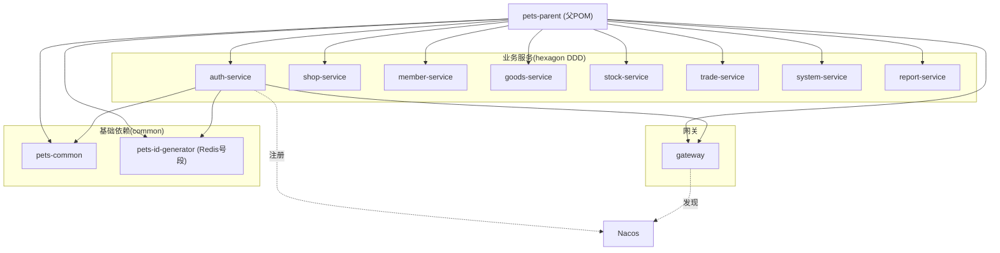

# 功能开发文档 · 02·多模块微服务脚手架

> 项目：宠老板复刻 · 里程碑：M0（F-001，P0）
> 作用：所有功能落地之基座，定义工程结构、分层规范与通用演进方式。

---

## 1. 功能概述

本功能建立**多模块 Maven 微服务工程**骨架：一个父 POM 管理 `gateway` 与 `auth/shop/member/goods/stock/trade/system/report` 八个业务服务，各服务采用 **DDD 六边形分层**，统一接入 Nacos（注册+配置）与 Gateway。学生在此骨架上逐模块填充业务。

- 核心产出：可启动的多模块骨架、统一依赖版本、Nacos 注册、Gateway 路由初配。
- 依赖前置：Java25、Maven、Nacos 可访问、MySQL/Redis 就绪。

---

## 2. 架构图



---

## 3. 工程结构

```text
pets-parent/                       # 父 POM (dependencyManagement)
├── pom.xml
├── pets-common/                   # 公共模块: 统一响应/异常/租户上下文/工具
├── pets-id-generator/             # Redis 号段发号器(可并入 common)
├── pets-gateway/                  # Spring Cloud Gateway
└── services/
    ├── auth-service/
    ├── shop-service/
    ├── member-service/
    ├── goods-service/
    ├── stock-service/
    ├── trade-service/
    ├── system-service/
    └── report-service/
```

### 单个服务内部（DDD 六边形）
```text
auth-service/
├── pom.xml
└── src/main/java/com/pets/auth/
    ├── AuthApplication.java
    ├── adapter/in/          # 入站适配: Controller(端口接收 HTTP)
    ├── adapter/out/         # 出站适配: Mapper/Repository 实现、外调 feign/mq
    ├── application/         # 用例编排(DTO、用例服务, 指挥领域)
    ├── domain/              # 领域模型、领域服务、仓库接口(port)
    └── config/              # 配置类
```

---

## 4. 关键依赖版本（父 POM management）

| 组件 | 版本 | 说明 |
|------|------|------|
| Spring Boot | 4.x | 微服务基座 |
| Java | 25 | 语言 |
| Spring Cloud Alibaba | 2025.1.x | Nacos、Gateway、Feign |
| MyBatis-Plus | 3.5.x | ORM |
| Knife4j | 5.x | API 文档 |
| JJWT | 0.13.x | JWT |
| Lombok | 1.18.x | 编译期 |
| RocketMQ | 5.x starter | 异步事件 |

---

## 5. 配置与应用

### 5.1 父 POM 要点
- `<parent>` Spring Boot starter-parent；`<modules>` 列举全部服务。
- `dependencyManagement` 统一版本；`pets-common`、`pets-id-generator` 设为公共依赖引入。

### 5.2 服务 bootstrap.yml（以 auth 为例，注册到 Nacos）
```yaml
spring:
  application:
    name: auth-service
  cloud:
    nacos:
      discovery:
        server-addr: ${NACOS_ADDR:localhost:8848}
      config:
        server-addr: ${NACOS_ADDR:localhost:8848}
        file-extension: yaml
server:
  port: 9001
```

### 5.3 Gateway 初配 application.yml
```yaml
spring:
  cloud:
    gateway:
      routes:
        - id: auth
          uri: lb://auth-service
          predicates:
            - Path=/api/v1/auth/**
```

---

## 6. 代码规范（团队约束）

1. 包名统一 `com.pets.{service}`；Controller 只做协议转换，业务在 `application`。
2. 各服务依赖 `pets-common`（响应/异常/上下文），禁止跨服务直接连他人表。
3. 跨服务调用走 Feign 或 MQ 事件，禁止同步 HTTP 直连数据库。
4. 配置凡环境相关一律走 Nacos，不留死参数。

---

## 7. 开发任务清单

- [ ] 生成父 POM + 8 个业务服务模块 + gateway + common（含目录结构）。
- [ ] `pets-common` 提供统一响应体 `R<T>`、全局异常、`AuthContextHolder`、`TraceIdFilter`。
- [ ] 每服务连通 Nacos 注册，启动后 Nacos 服务列表可见。
- [ ] Gateway 路由 `lb://` 可达 auth-service 健康端点。
- [ ] MyBatis-Plus 数据源（MySQL）连通，Knife4j 文档页可访问。
- [ ] 提交代码并配置 Gitea Actions 触发构建。

---

## 8. 验收标准（DoD）

- [ ] `mvn -pl services/auth-service spring-boot:run` 可启动并注册 Nacos。
- [ ] 访问 Gateway 健康端点 200，路由转发到 auth-service。
- [ ] Knife4j 文档页正常展示。
- [ ] 模块目录符合六边形分层，公共组件可供各服务引用。