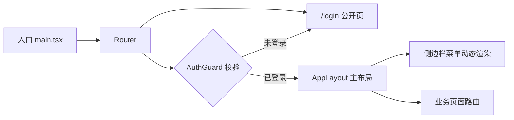

# 功能开发文档 · 03·前端工程骨架

> 项目：宠老板复刻 · 里程碑：M0（F-002，P0）
> 作用：建立 React 前端基座，含路由守卫、请求封装、状态管理、布局，供各业务页面挂载。

---

## 1. 功能概述

建立**React + Vite + Ant Design 5** 前端工程骨架：路由体系、Axios 拦截器、Zustand 状态、全局布局（侧边栏+顶栏）、登录守卫。后续各业务页面（登录/收银/订单等）在此骨架上新增。

- 核心产出：可启动的 Vite 工程、路由守卫、请求封装、菜单布局。
- 依赖前置：Node 20+、pnpm、后端 api（可代理）。

---

## 2. 页面流向



---

## 3. 工程结构

```text
frontend/
├── package.json
├── vite.config.ts
├── index.html
└── src/
    ├── main.tsx
    ├── App.tsx
    ├── router/index.tsx      # 路由表 + AuthGuard
    ├── layouts/AppLayout.tsx # 侧边栏+顶栏+Outlet
    ├── api/                  # 接口模块(login.ts, survey.ts...)
    ├── store/                # Zustand(authStore, appStore)
    ├── components/           # 通用组件
    ├── pages/                # 页面
    ├── utils/request.tsx     # Axios 封装
    └── utils/auth.ts         # token 持久化
```

---

## 4. 关键技术点

### 4.1 Axios 封装（utils/request.tsx）
```ts
const request = axios.create({ baseURL: import.meta.env.VITE_API_BASE });
request.interceptors.request.use(cfg => {
  cfg.headers.Authorization = `Bearer ${authStore.getState().token}`;
  cfg.headers.lang = 'zh-cn';
  return cfg;
});
request.interceptors.response.use(res => {
  if (res.data.code !== 0) { message.error(res.data.msg); return Promise.reject(res.data); }
  if (res.status === 401) { authStore.getState().logout(); window.location.href = '/login'; }
  return res.data;
});
```

### 4.2 AuthGuard（router/index.tsx）
- `/login` 公开；其余路由经 `AuthGuard` 判断 `token` 存在与否，未登录重定向 `/login`。

### 4.3 菜单布局（AppLayout.tsx）
- `Layout.Menu` 依据路由表渲染侧边栏子菜单；`Outlet` 渲染当前页面。

---

## 5. 开发任务清单

- [ ] `pnpm create vite` 初始化 + 安装 antd/react-router/zustand/axios。
- [ ] 配置 `vite.config.ts`（代理 `/api` → gateway，环境变量 `VITE_API_BASE`）。
- [ ] 实现 `utils/request.tsx` 请求/响应拦截器。
- [ ] 实现 `router` + `AuthGuard` + `AppLayout` 骨架。
- [ ] 空登录页占位，`main.tsx` 挂 Router + ConfigProvider(zhCN)。
- [ ] `pnpm dev` 启动，路由跳转与守卫生效。

---

## 6. 验收标准（DoD）

- [ ] `pnpm dev` 启动，访问 `/` 自动跳 `/login`。
- [ ] 侧边栏+顶栏布局渲染，路由可切换。
- [ ] 请求拦截挂载 token/lang 头，响应统一处理 code/401。