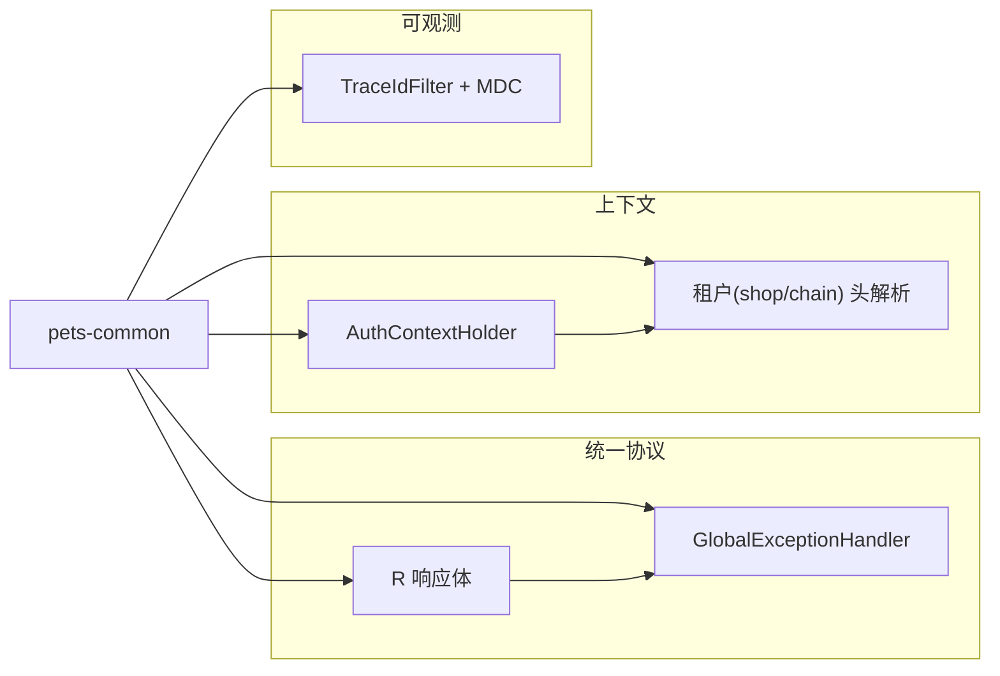

# 功能开发文档 · 04·统一公共组件

> 项目：宠老板复刻 · 里程碑：M0（F-003，P0）
> 作用：沉淀各微服务共用的横切能力，保证全系统一致性：统一响应、全局异常、租户上下文、traceId 日志。

---

## 1. 功能概述

在 `pets-common` 模块落地一组**公共横切组件**，供所有业务服务引用，形成统一协议与可观测基础，避免各服务各自为政。

- 核心产出：统一响应体 `R<T>`、全局异常处理器、认证/租户上下文器具、traceId 日志过滤器。
- 前置：M0 脚手架、Spring Web/Feign、logback。

---

## 2. 组件清单



---

## 3. 详细设计

### 3.1 统一响应体 `R<T>`
```java
public record R<T>(int code, String msg, T data, PageResult page) {
    public static <T> R<T> ok(T data){ return new R<>(0,"成功",data,null); }
    public static <T> R<T> fail(int code,String msg){ return new R<>(code,msg,null,null); }
}
```
- 约定 `code=0` 成功；`code!=0` 携带业务错误码。
- 分页用 `PageResult{page_num,page_size,total}`，与前端约定一致。

### 3.2 全局异常 `@RestControllerAdvice`
统一处理：`BizException`（业务错误）、参数校验 `MethodArgumentNotValidException`、`AccessDeniedException`(403)、兜底 `Exception`，均转为 `R.fail`，不泄漏堆栈。

### 3.3 AuthContextHolder（租户上下文）
- `ThreadLocal` 持有当前请求解析出的 `userId`、`shopId`、`chainGroupId`。
- 由网关注入请求头 `X-User-Id / X-Shop-Id / X-Chain-Group-Id`，服务端过滤器读入 Holder。
- 请求结束 `finally` 清理，防止线程复用串号。

### 3.4 TraceId 日志
- `TraceIdFilter`：入口生成/透传 `traceId`，写入 `MDC`，响应头回传。
- logback pattern 输出 `[%X{traceId}]`，联动 SkyWalking/Loki 排查。

---

## 4. 代码落点

```
pets-common/src/main/java/com/pets/common/
    web/R.java  /  PageResult.java
    exception/BizException.java / GlobalExceptionHandler.java
    context/AuthContextHolder.java / TenantFilter.java
    log/TraceIdFilter.java
    util/... (HttpUtil, JsonUtil)
```

---

## 5. 开发任务清单

- [ ] 实现 `R<T>`、`PageResult`。
- [ ] 实现 `BizException` + 全局异常处理器。
- [ ] 实现 `AuthContextHolder` + 租户头解析 `TenantFilter`。
- [ ] 实现 `TraceIdFilter`（生成/透传/清理 MDC）+ logback pattern。
- [ ] auth-service 先接入验证：异常返回统一体、tenant 生效、日志有 traceId。

---

## 6. 验收标准（DoD）

- [ ] 服务抛异常时前端收到 `{code,msg}` 统一体，错误提示正常。
- [ ] 带 `X-Shop-Id` 请求可被 `AuthContextHolder` 读取；线程池复用无串号。
- [ ] 每条访问日志含唯一 `traceId`。