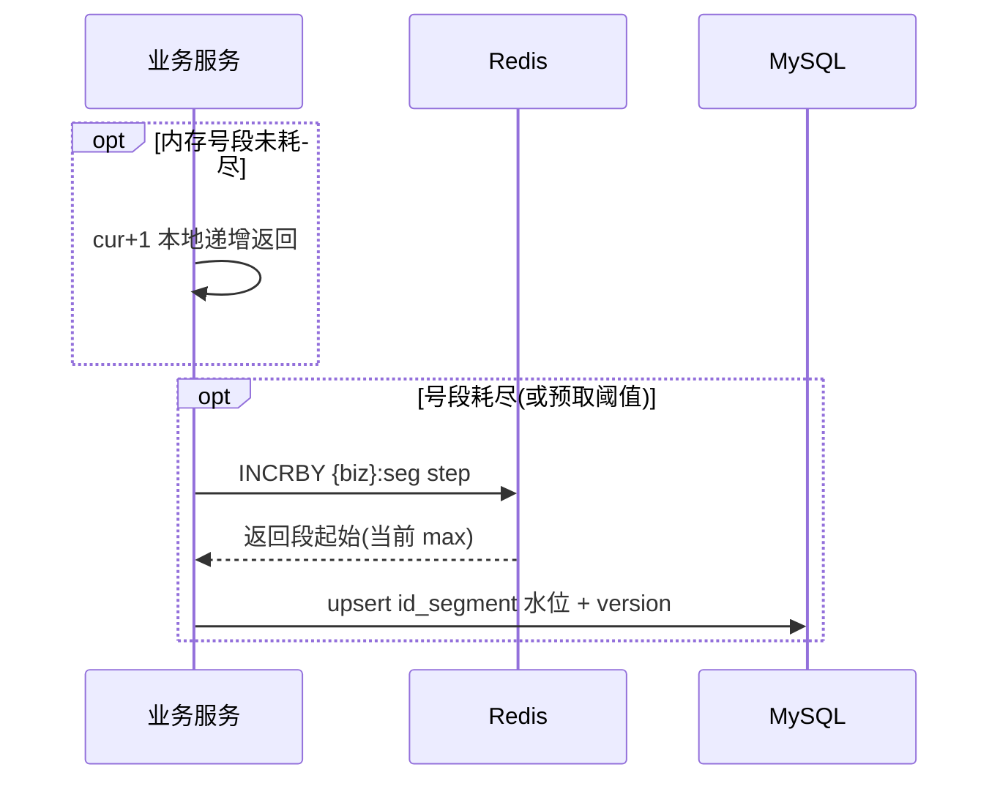

# 功能开发文档 · 05·分布式ID（Redis 号段模式）

> 项目：宠老板复刻 · 里程碑：M0（F-004，P0）
> 作用：为订单、会员、商品等跨服务主键提供全局唯一、趋势递增、高性能的 ID，替代 DB 自增。

---

## 1. 功能概述

实现 **Redis 号段发号器**（改进自 Leaf-Segment）：将一段连续 ID 预取到服务内存，应用内自增使用，号段耗尽再向 Redis 申请下一段并回写 MySQL 水位，兼顾性能、唯一性与重启安全。

- 核心产出：`pets-id-generator` 公共模块、`id_segment` 号段表、`IdGenerator` API。
- 前置：Redis、MySQL、pets-common。

---

## 2. 设计流程



---

## 3. 表结构

### 3.1 号段表 `id_segment`
| 字段 | 类型 | 说明 |
|------|------|------|
| id | bigint PK | 主键 |
| biz_type | varchar(40) | 业务类型（order/member/goods/...），唯一 |
| max_id | bigint | 已分配的号段上界 |
| step | int | 号段步长，如 1000 |
| version | int | 乐观锁版本，防并发覆写 |
| update_time | datetime | 更新时间 |

初始化 SQL：
```sql
INSERT INTO id_segment(biz_type,max_id,step,version) VALUES('order',0,1000,0);
INSERT INTO id_segment(biz_type,max_id,step,version) VALUES('member',0,1000,0);
```

---

## 4. 实现要点

- **双重保障**：Redis `INCRBY key step` 分配号段（起始=旧max+1~step）；下次以 MySQL 表为持久水位，Redis 故障时降级仅用 DB 乐观锁分配。
- **预取**：内存剩余 ≤20%（阈值）即异步申请下一段，避免高峰阻塞。
- **线程安全**：分段用 `AtomicLong` 维护当前游标 + 号段上界；被多线程共享时用 `synchronized`/CAS 保证取号原子。
- **单调性**：单实例内严格递增；跨实例整体趋势递增，对 MySQL 主键索引友好。

---

## 5. 接口
```java
// IdService
public interface IdService {
    long next(String bizType);      // 同步取下一个 ID
    List<Long> nextBatch(String bizType, int n); // 批量取
}
```
规则：ID 长度 19 位以内；不依赖时钟，无 DST 跳变风险。

---

## 6. 代码落点
```
pets-id-generator/src/main/java/com/pets/id/
    config/IdGeneratorAutoConfiguration.java
    service/IdService.java / RedisSegmentIdService.java
    repo/SegmentRepository.java  (MyBatis-Plus 操作 id_segment)
    properties/IdGeneratorProperties.java  (step 可配)
```

---

## 7. 开发任务清单

- [ ] 建表 `id_segment`，写初始化数据。
- [ ] 实现 `SegmentRepository`（查/upsert 水位，乐观锁）。
- [ ] 实现 `RedisSegmentIdService`（Redis INCRBY 取段 + 内存游标）。
- [ ] 实现预取与线程安全取号；暴露 `IdService` 自动装配。
- [ ] 单测：并发取号唯一性、号段耗尽续段、重启后不重复。
- [ ] auth-service 中成员/员工持久化改用 `idService.next("clerk")` 验证。

---

## 8. 验收标准（DoD）

- [ ] 100 并发取号 1w 无重复、增速稳定。
- [ ] 号段耗尽自动续段，重启后从 MySQL 水位续号不重复。
- [ ] 渐进递增，插入 MySQL 主键正常无页分裂异常增长。