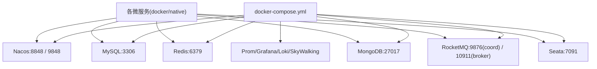

# 功能开发文档 · 06·基建环境（Docker Compose）

> 项目：宠老板复刻 · 里程碑：M0（F-005，P0）
> 作用：一键拉起全套中间件，供本地开发与 Ubuntu 26 部署复用，含数据库、缓存、消息、事务、注册/配置、可观测。

---

## 1. 功能概述

提供 `docker-compose.yml`，编排以下服务，实现「一条命令起全部」：
**Nacos**（注册+配置）、**MySQL**、**Redis**、**MongoDB**、**RocketMQ**、**Seata**（可选）、**可观测**（Prometheus/Grafana/Loki/SkyWalking，F-003 配套）。

> **MongoDB 用途**：短信验证码留痕（`sms_code`）、登录日志（`login_log`）—— 高吞吐写入、TTL 自动过期，不占用 MySQL 事务资源。实时校验仍走 Redis。

- 前置：Docker + Docker Compose v2；Ubuntu 26 / Mac 均可。
- 注意：本机端口冲突时通过 `.env` 覆盖。

---

## 2. 服务拓扑



---

## 3. compose 关键片段

```yaml
services:
  mysql:
    image: mysql:8.0
    environment:
      MYSQL_ROOT_PASSWORD: root123
      MYSQL_DATABASE: pets
    ports: ["3306:3306"]
    volumes: [mysql-data:/var/lib/mysql]

  redis:
    image: redis:7
    command: redis-server --appendonly yes
    ports: ["6379:6379"]

  mongodb:
    image: mongo:7
    environment:
      MONGO_INITDB_ROOT_USERNAME: root
      MONGO_INITDB_ROOT_PASSWORD: root123
      MONGO_INITDB_DATABASE: pets
    ports: ["27017:27017"]
    volumes:
      - mongo-data:/data/db
      - ./scripts/mongodb:/docker-entrypoint-initdb.d  # 自动执行 init 脚本

  nacos:
    image: nacos/nacos-server:v2.3.0
    ports: ["8848:8848", "9848:9848"]
    environment:
      MODE: standalone

  rocketmq:
    image: apache/rocketmq:5.x
    # 单机 ns + broker 两个容器，详见 files/rocketmq

  seata:
    image: seataio/seata-server:1.8
    environment:
      SEATA_IP: 127.0.0.1
    ports: ["7091:7091"]

volumes:
  mysql-data:
  mongo-data:
```

完整编排含 Prometheus/Grafana/Loki/SkyWalking（随 M3 可观测接入启用，可 `profiles: ["obs"]` 按需启动，见下节）。

---

## 4. 可观测（可选用 `--profile obs`）

- Prometheus 抓取 `/actuator/prometheus`；Grafana 3000 端口；
- Loki 3000/3100 聚合日志；SkyWalking OAP 11800/UI 8080。

```bash
# 仅起核心中间件
docker compose up -d mysql redis mongodb nacos rocketmq seata
# 含可观测栈
docker compose --profile obs up -d
```

---

## 5. Gitea / 服务器说明

- 代码托管走 Gitea（独立于 compose），CI 产物可用同一网络部署到 Ubuntu 26。
- 各服务 `spring.cloud.nacos.discovery.server-addr` 指向本机或服务器地址，通过环境变量 `NACOS_ADDR` 注入。

---

## 6. 开发任务清单

- [ ] 编写 `docker-compose.yml`（含 MySQL/Redis/MongoDB/Nacos/RocketMQ/Seata）。
- [ ] 编写 RocketMQ 单机 broker/ns 子编排。
- [ ] 编写可观测 profile（Prom/Grafana/Loki/SkyWalking）。
- [ ] 提供 `/scripts/mysql/01-auth-ddl.sql`（M1 建表）、`/scripts/mysql/02-auth-seed.sql`（种子数据）。
- [ ] 提供 `/scripts/mongodb/01-auth-init.js`（集合 + TTL 索引初始化）。
- [ ] `docker compose up -d` 后验证各端口与调用连通。
- [ ] 整理 `.env` 配置项与说明。

---

## 7. 验收标准（DoD）

- [ ] 一条命令拉起全部核心中间件，各健康端口可访问。
- [ ] Nacos 控制台可登录、MySQL 可建库表、Redis 可读写、MongoDB 集合与索引已初始化、RocketMQ 收发正常。
- [ ] `--profile obs` 可启动可观测栈，Prometheus 能抓取到示例服务指标。