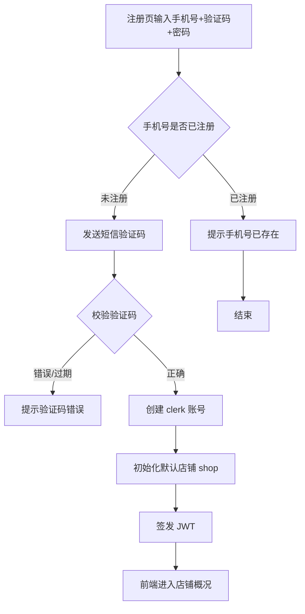

# 功能开发文档 · 07·注册

> 项目：宠老板复刻 · 里程碑：M1（F-011，P0）
> 作用：支持新用户以「手机号 + 短信验证码 + 密码」自助注册，注册成功后直接签发 JWT 登录。

---

## 1. 功能概述

实现用户**注册**：校验手机号未占用、短信验证码正确后创建员工(`clerk`)账号，绑定首个默认店铺或加入已有店铺，并自动签发 JWT 完成一次登录。

- 核心产出：`POST /api/v1/auth/register`、短信验证码发送/校验、默认租户初始化。
- 前置：M0 脚手架、Redis（验证码）、MySQL（clerk/shop）、Redis 号段、F-010 登录的 JWT 复用。

---

## 2. 业务流程图



---

## 3. 需求明细

| 编号 | 功能点 | 说明 | 优先级 |
|------|--------|------|--------|
| R-01 | 发送短信验证码 | 下发至手机，限频+有效期 | P0 |
| R-02 | 校验验证码 | 防重放、防爆破 | P0 |
| R-03 | 手机号唯一性 | 已注册则拒绝 | P0 |
| R-04 | 创建账号+店铺 | 默认店铺初始化 | P0 |
| R-05 | 注册即登录 | 注册成功签发 JWT | P0 |

---

## 4. 表结构

- `clerk`：参考 01 文档 F-010；注册时插入 `phone/password/truename`，`status=1`。
- `shop`：首次注册建默认店铺（shop_name 可取手机号或占位）。
- 验证码：存 Redis `sms:code:{phone}`，`TTL=5min`，验证后删除。

---

## 5. 接口设计

### 5.1 POST /api/v1/auth/send-code
```json
// 请求
{ "phone":"15638538859", "scene":"register" }
// 响应
{ "code":0, "msg":"验证码已发送", "data":null }
```
- 限频：同号 60s 内不重复下发（Redis `sms:limit:` 计数）。
- 场景枚举：`register` / `reset`，与后端校验逻辑对应。

### 5.2 POST /api/v1/auth/register
```json
// 请求
{ "phone":"15638538859", "code":"1234", "password":"******" }
// 响应
{ "code":0, "msg":"注册成功", "data":{ "token":"eyJ...", "shop_id":80351 } }
```
- 校验顺序：仅 `scene=register` 的码 → 手机号未注册 → 创建 clerk（DB `id` 用 Redis 号段）→ 初始化 shop → 签发 JWT。

---

## 6. 前端设计（注册页）
- `Register.tsx`：三级表单组件——手机号 → 验证码（含倒计时）→ 密码；成功后跳转店铺概况。
- 校验规则由 Ant Form 控制（手机号/密码强度）。

---

## 7. 代码落点
```
auth-service/
    controller/AuthController.java        (+sendCode, register)
    service/SmsCodeService.java           (发码/校验)
    dto/SendCodeReq.java / RegisterReq.java
    service/RegisterService.java
frontend/src/pages/login/Register.tsx
frontend/src/api/auth.ts                  (+sendCode, register)
```

---

## 8. 开发任务清单

- [ ] `SmsCodeService`：发码（限频、Redis TTL、场景绑定）+ 校验（删除策略）。
- [ ] `RegisterService`：唯一性校验 → 创建 clerk + 默认 shop（Redis 号段）→ 签发 JWT。
- [ ] `AuthController` 暴露 `send-code` / `register` 两端点。
- [ ] 前端 `Register.tsx` + 验证码倒计时 + 成功后跳转。
- [ ] 自测：重复手机号拒绝、错误码拦截、token 有效性。

---

## 9. 验收标准（DoD）

- [ ] 新手机号可注册成功，返回有效 JWT 与 shop_id。
- [ ] 已注册手机号明确提示，不发验证码或注册被拒。
- [ ] 验证码错误/过期被拦截；60s 限频生效。
- [ ] 注册后 `clerk`、`shop`、`id_segment` 数据正确落库。