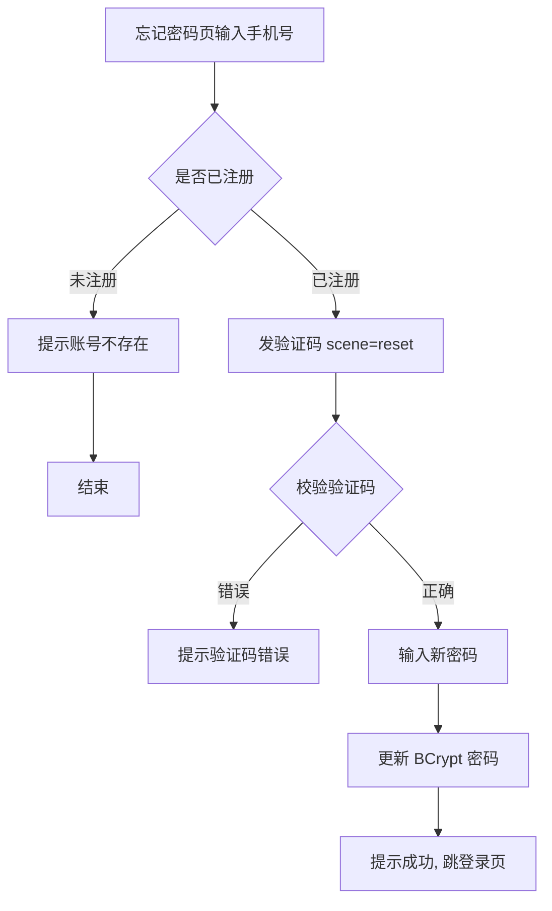

# 功能开发文档 · 08·忘记密码

> 项目：宠老板复刻 · 里程碑：M1（F-012，P0）
> 作用：已注册用户忘记密码时，通过「手机号 + 短信验证码」安全重置密码。

---

## 1. 功能概述

提供**忘记密码**：校验手机号已注册且短信验证码正确后，更新用户密码（BCrypt），引导其重新登录。

- 核心产出：`POST /api/v1/auth/reset-password`、复用 `send-code`（scene=reset）。
- 前置：F-011 `SmsCodeService` 复用验证码能力。

---

## 2. 业务流程图



---

## 3. 需求明细

| 编号 | 功能点 | 说明 | 优先级 |
|------|--------|------|--------|
| R-01 | 是否注册校验 | 未注册提示 | P0 |
| R-02 | 发码(scene=reset) | 复用 send-code | P0 |
| R-03 | 重置密码 | BCrypt 更新 | P0 |
| R-04 | 安全约束 | 密码强度、最小长度 | P0 |

---

## 4. 接口设计

### 4.1 POST /api/v1/auth/send-code（scene=reset）
```json
{ "phone":"15638538859", "scene":"reset" }
```
- 发放前校验手机号已注册，避免对未注册号码下发。

### 4.2 POST /api/v1/auth/reset-password
```json
// 请求
{ "phone":"15638538859", "code":"1234", "newPassword":"******" }
// 响应
{ "code":0, "msg":"密码重置成功", "data":null }
```
- 校验：`scene=reset` 验证码 → 新密码强度 → `clerk.password = BCrypt(new)` → 作废旧 token。

---

## 5. 安全要点

- 重置后使该用户旧 JWT 失效：校验时比对 `clerk.password` 变更后的 token 版本号，或引入 `pwd_version` 字段。
- 密码统一 BCrypt 加盐存储，禁止明文/可逆加密。
- 验证码一次有效（校验后删除），防重放。

---

## 6. 前端设计（ForgetPassword.tsx）
- 两步表单：手机号+验证码 → 新密码+确认密码；成功后跳登录页。
- 密码一致性前端校验。

---

## 7. 代码落点
```
auth-service/
    controller/AuthController.java    (+resetPassword)
    service/ResetPasswordService.java
    dto/ResetPasswordReq.java
frontend/src/pages/login/ForgetPassword.tsx
frontend/src/api/auth.ts              (+resetPassword)
```

---

## 8. 开发任务清单

- [ ] `ResetPasswordService`：注册校验 → 验证码校验 → BCrypt 更新 → 版本失效。
- [ ] `AuthController.createController` 暴露 `reset-password`。
- [ ] `send-code` 支持 `scene=reset` 且校验已注册。
- [ ] 前端 `ForgetPassword.tsx`。
- [ ] 自测：未注册拦截、错误码拦截、重置后可登录、旧 token 失效。

---

## 9. 验收标准（DoD）

- [ ] 正确流程可重置密码，新密码可正常登录。
- [ ] 未注册手机号/错误验证码被拦截并给出明确提示。
- [ ] 密码以 BCrypt 密文存储，无明文泄露。
- [ ] 重置后旧 token 立即失效。