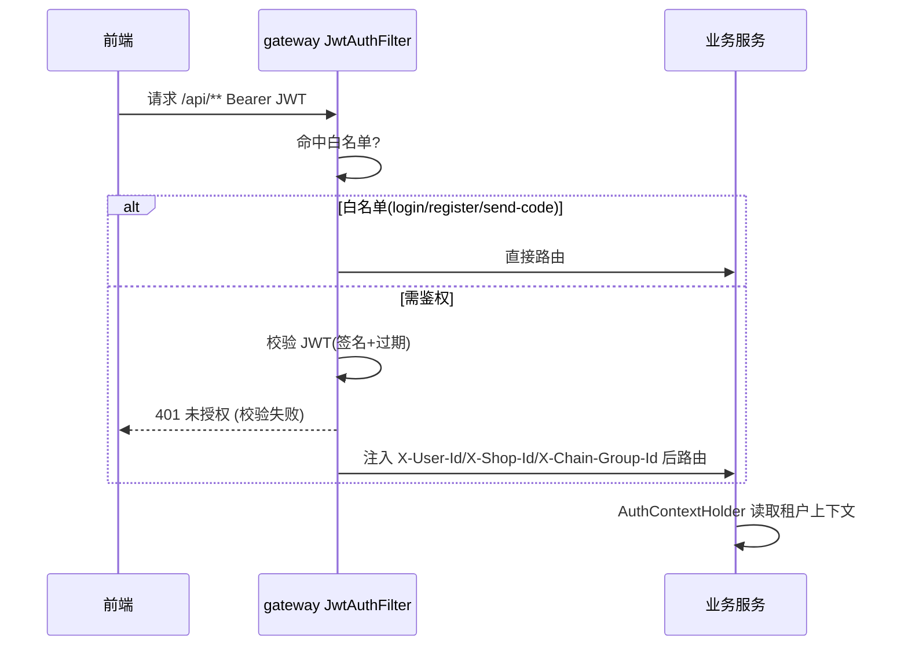

# 功能开发文档 · 09·网关鉴权与租户透传

> 项目：宠老板复刻 · 里程碑：M1（F-013，P0）
> 作用：在网关层统一校验 JWT、放行白名单，并把用户/租户上下文透传下游服务，形成统一安全边界。

---

## 1. 功能概述

在 `pets-gateway` 实现**全局鉴权过滤器**：对所有入站请求校验 `Authorization: Bearer {jwt}`，校验通过后解析出 `userId/shopId/chainGroupId` 并注入请求头，传输至各业务服务。白名单（如登录/注册）直接放行。

- 核心产出：`JwtAuthGlobalFilter`、JWT 解析共享、白名单配置、401 拦截。
- 前置：F-003 公共组件(租户上下文约定)、JJWT、auth-service 登录。

---

## 2. 调用时序



---

## 3. 实现要点

### 3.1 JWT 校验
```java
// 解析 JWT，失败抛 BizException(401)
Claims claims = Jwts.parser().verifyWith(key).build()
                    .parseSignedClaims(token).getPayload();
// 校验通过后读取 sub/userId, shopId, chainGroupId
```

### 3.2 透传头注入
- `X-User-Id`、`X-Shop-Id`、`X-Chain-Group-Id`、`X-Trace-Id`。
- 业务服务侧（F-003 `TenantFilter`）读取，供 `AuthContextHolder` 使用。

### 3.3 白名单
```yaml
pets:
  auth:
    white-list:
      - /api/v1/auth/login
      - /api/v1/auth/register
      - /api/v1/auth/send-code
      - /api/v1/auth/reset-password
      - /actuator/health
```

---

## 4. 代码落点
```
pets-gateway/src/main/java/com/pets/gateway/
    config/RouteConfig.java
    filter/JwtAuthGlobalFilter.java
    properties/WhiteListProperties.java
    util/RouteUtil.java
```

---

## 5. 开发任务清单

- [ ] `WhiteListProperties` 白名单配置 + yaml。
- [ ] `JwtAuthGlobalFilter`：校验、解析、注入头、401 兜底。
- [ ] 传递 `X-Trace-Id`（配合 F-003）。
- [ ] 以 auth-service 验证：登录白名单放行、其余需 token、注入头下游可读。

---

## 6. 验收标准（DoD）

- [ ] 白名单路径无 token 可访问；其余路径无/错/过期 token 均 401。
- [ ] 校验通过后下游能读到 `X-Shop-Id` 等上下文。
- [ ] 敏感错误不泄露，响应为统一 `{code,msg}`。