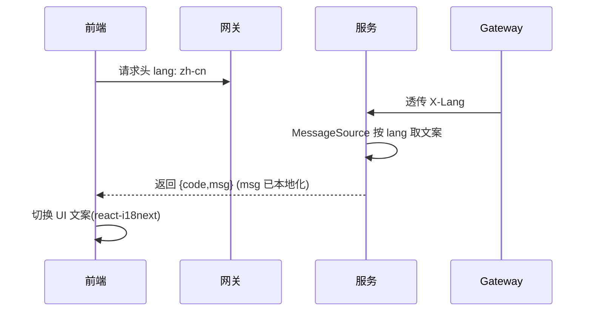

# 功能开发文档 · 11·多语言（zh-cn）

> 项目：宠老板复刻 · 里程碑：M1（F-015，P1）
> 作用：为前后端建立多语言基础，首期落地中文(zh-cn)，预留扩展，满足原系统多语言能力。

---

## 1. 功能概述

搭建**国际化(i18n)**基础设施：前端 `react-i18next` 语言包与切换，后端错误码/消息多语言化，网关与请求头带 `lang` 上下文，实现中文环境默认闭环。

- 核心产出：前端语言包+切换器、后端消息源(`lang` 头映射)、默认 zh-cn。
- 前置：F-002 前端骨架、F-003 公共组件、F-013 网关。

---

## 2. 语言上下文流转



---

## 3. 前端设计

### 3.1 react-i18next 接入
```ts
// i18n.ts
i18n.use(initReactI18next).init({
  resources: { 'zh-cn': { translation: zhCN }, 'en-US': { translation: enUS } },
  lng: 'zh-cn',
});
```

### 3.2 语言包
```
frontend/src/locales/
    zh-cn/common.ts   (登录/导航/按钮/提示 通用文案)
    zh-cn/auth.ts
    en-US/common.ts   (预留扩展)
```
- 切换器置于顶栏（可选中/右下角收起），写入 `localStorage.lang`，并同步请求头 `lang`。

---

## 4. 后端设计

### 4.1 消息源
```yaml
spring:
  messages:
    basename: i18n/messages
    encoding: UTF-8
```
- `resources/i18n/messages_zh.properties`、`messages_en.properties`。
- `BizException` 提供 `messageKey`，全局异常用 `MessageSource` 按 `X-Lang` 渲染中文/英文。

### 4.2 lang 透传
- 网关透传 `X-Lang`（默认 zh-cn）；服务侧拦截器取 `X-Lang` 或请求头 `lang` 放入上下文。

---

## 5. 代码落点
```
frontend/src/locales/*.ts + i18n.ts
frontend/src/components/LangSwitcher.tsx
pets-common/src/main/resources/i18n/messages_*.properties
pets-common/.../context/LangHolder.java
```

---

## 6. 开发任务清单

- [ ] 前端接入 `react-i18next`，建 zh-cn 语言包与切换组件。
- [ ] 请求头统一带 `lang`。
- [ ] 后端建 `messages_zh/en`，`BizException` 支持 messageKey。
- [ ] 登录错误（如「密码错误」）随 lang 变化。
- [ ] 自测：切英文后 UI 与后端错误文案同步变化。

---

## 7. 验收标准（DoD）

- [ ] 切换 `en-US`/`zh-cn`，前端菜单与按钮文案即时变化。
- [ ] 后端业务错误消息随 `lang` 返回对应语言。
- [ ] 默认 `zh-cn` 生效，无请求头时按中文返回。