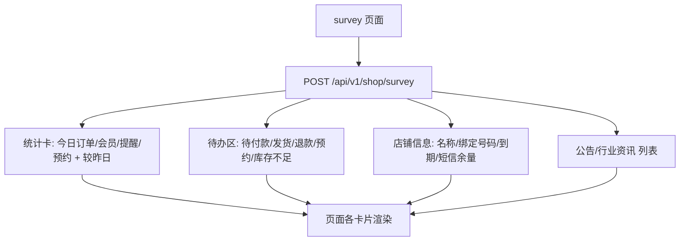

# 功能开发文档 · 12·店铺概况看板

> 项目：宠老板复刻 · 里程碑：M2（F-020，P0）
> 作用：登录后首屏「店铺概况」— 多维度经营指标聚合展示，让运营一眼掌握店铺当日状态。

---

## 1. 功能概述

实现登录后默认首页**店铺概况看板**：今日订单/会员/提醒/预约统计（含较昨日趋势）、待办区（待付款/待发货/待退款/预约待处理/库存不足）、店铺信息卡与公告资讯。

- 核心产出：`GET/POST /api/v1/shop/survey` 聚合接口、前端看板页。
- 前置：F-010 鉴权、Redis 号段、各业务表就绪（订单/会员/库存）。
- 说明：依赖 M1~M5 部分数据，可先接通数据源返回占位/真实值。

---

## 2. 看板布局与数据流



---

## 3. 需求明细

| 编号 | 功能点 | 说明 | 优先级 |
|------|--------|------|--------|
| R-01 | 统计卡四项 | 今日订单/会员/提醒/预约 + 较昨日增减 | P0 |
| R-02 | 待办区 | 待付款/待发货/待退款/预约待处理/库存不足计数 | P0 |
| R-03 | 店铺信息卡 | 店铺名/绑定号码/到期时间/短信余量 | P0 |
| R-04 | 公告与资讯 | 公告通知、行业资讯列表 | P1 |
| R-05 | 查看更多跳转 | 各待办链接至对应列表页 | P1 |

---

## 4. 接口设计

### 4.1 POST /api/v1/shop/survey
```json
// 请求
{ }   // 租户信息从 X-Shop-Id 头读取
// 响应
{ "code":0, "msg":"成功",
  "data":{
    "statistics":{
      "todayOrder":12, "orderTrend":"+2", "todayMember":3, "memberTrend":"+1",
      "todayReminder":0, "reminderTrend":"0","todayAppointment":1, "appointmentTrend":"+1"
    },
    "todo":{
      "waitPay":3, "waitDeliver":1, "waitRefund":0,
      "waitAppointment":2, "stockShortage":4
    },
    "shop":{ "shopName":"艾妮塔宠物生活馆","bindPhone":"15638538859",
             "expireTime":"2026-12-31","smsRemain":120 },
    "news":[ { "id":1, "title":"门店升级通知", "type":"announcement", "time":"2026-09-18" } ]
  }}
```
- 统计卡「较昨日」由当日汇总与昨日同口径比对得出（可先由 Redis 缓存夜间任务计算，或实时 count）。

---

## 5. 数据来源预案

因看板横跨订单/会员/库存，**首期**可聚合自单表并返回真实可用部分，未接通部分返回 0：
- 今日订单：`sale_order` 当日 count（M3 后接真实）。
- 今日会员：`member` 当日 count（M5 后接真实）。
- 库存不足：`stock` 低于预警数量 count。
- 公告：`notice` 表。

> 教学说明：本接口是典型的「跨服务聚合」示例，正式实现可引入 **report-service** 或 RocketMQ 异步预汇总。

---

## 6. 前端设计（survey 页）
- `pages/survey/index.tsx`：`Row/Col` 布局——顶部四张统计卡（含趋势箭头）、中部待办卡片（链接）+ 店铺信息卡、下方公告列表。
- Antd `Statistic`、`Badge`、`List` 组件；空数据态展示「暂无数据」。

---

## 7. 代码落点
```
services/shop-service/
    controller/ShopSurveyController.java
    service/SurveyService.java
    dto/SurveyVO.java
    mapper/NoticeMapper.java (公告)
frontend/src/pages/survey/index.tsx
frontend/src/api/survey.ts
```

---

## 8. 开发任务清单

- [ ] `SurveyService`：聚合统计卡/待办/店铺信息/公告。
- [ ] `SurveyVO` 结构体与 `ShopSurveyController`。
- [ ] 前端 survey 页面四卡 + 待办 + 店铺信息 + 公告渲染。
- [ ] 与 M3/M5 数据源打通（或先返回占位 0）。
- [ ] 自测：登录后进入看板，各卡片取值与跳转正确。

---

## 9. 验收标准（DoD）

- [ ] 登录默认展示店铺概况，四张统计卡与趋势正常。
- [ ] 待办区各计数准确，「查看更多」跳转正确。
- [ ] 店铺信息/公告列表正常展示，空数据有友好提示。
- [ ] 接口统一响应与错误处理符合规范。