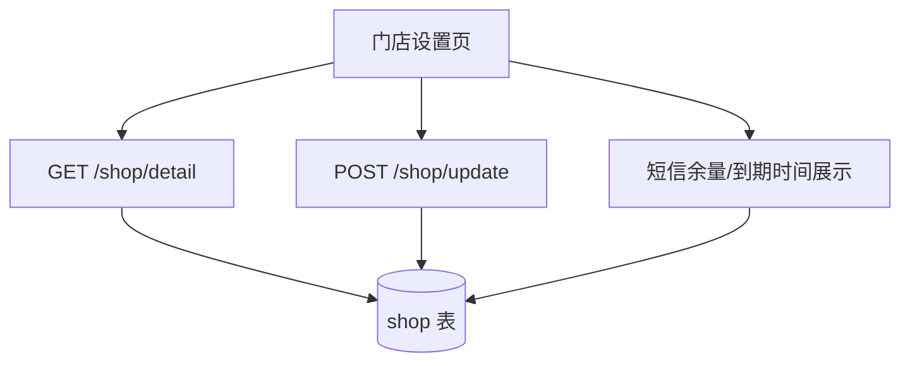

# 功能开发文档 · 13·门店管理

> 项目：宠老板复刻 · 里程碑：M2（F-021，P1）
> 作用：管理当前店铺资料、绑定号码、有效期、短信余量等基础信息。

---

## 1. 功能概述

提供**门店信息维护与查看**：展示/编辑店铺资料（名称、logo、地址、联系方式），绑定手机号，查看版本等级、到期时间、短信余量。

- 核心产出：店铺详情查看 + 资料编辑接口、前端门店设置页。
- 前置：M0 脚手架、M1 鉴权、`shop` 表。

---

## 2. 数据流



---

## 3. 需求明细

| 编号 | 功能点 | 说明 | 优先级 |
|------|--------|------|--------|
| R-01 | 查看门店详情 | 资料+绑定号码+到期+短信余量 | P0 |
| R-02 | 编辑资料 | 名称/logo/地址/电话 | P1 |
| R-03 | 版本信息 | level 版本等级展示 | P1 |
| R-04 | 短信余量 | 余量展示（先静态/预留） | P2 |

---

## 4. 接口设计

### 4.1 POST /api/v1/shop/detail
```json
// 响应 data
{ "id":80351, "shopName":"艾妮塔宠物生活馆", "logo":"",
  "bindPhone":"15638538859", "level":3, "expireTime":"2026-12-31",
  "smsRemain":120, "addr":"", "telephone":"" }
```

### 4.2 POST /api/v1/shop/update
```json
// 请求
{ "shopName":"艾妮塔宠物生活馆", "logo":"url", "addr":"xx路1号", "telephone":"0571-xxx" }
```
- 从 `X-Shop-Id` 定位当前店铺，仅允许合法值更新。

---

## 5. 表结构 `shop`
| 字段 | 类型 | 说明 |
|------|------|------|
| id | bigint PK | shop_id |
| shop_name | varchar | 店铺名 |
| logo | varchar | logo |
| bind_phone | varchar | 绑定号码 |
| level | int | 版本等级 |
| expire_time | datetime | 到期时间 |
| sms_remain | int | 短信余量 |
| addr / telephone | varchar | 地址/电话 |

---

## 6. 前端设计
- `pages/shop/Setting.tsx`：表单展示 + 可编辑；只读字段用 `Descriptions`。

---

## 7. 代码落点
```
shop-service/controller/ShopController.java
  service/ShopService.java / mapper/ShopMapper.java
frontend/src/pages/shop/Setting.tsx
frontend/src/api/shop.ts
```

---

## 8. 开发任务清单

- [ ] `ShopService`：detail / update。
- [ ] `ShopController` 两端点。
- [ ] 前端门店设置页（详情展示 + 编辑）。
- [ ] 自测：正确 shop 上下文的增查，非法值校验。

---

## 9. 验收标准（DoD）

- [ ] 门店详情正确展示，资料可保存生效。
- [ ] 仅当前租户店铺可读写，无权访问被拦。
- [ ] 表单校验（必填/格式）通过。