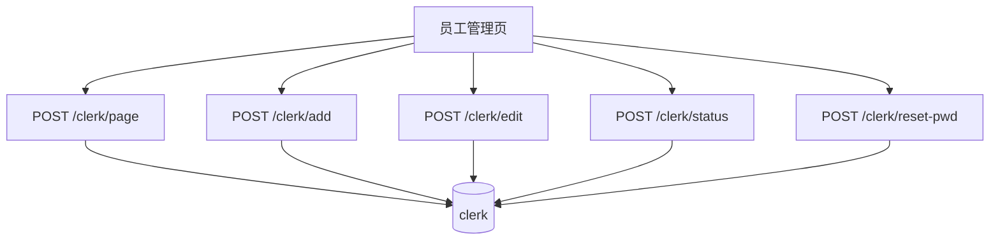

# 功能开发文档 · 14·员工管理

> 项目：宠老板复刻 · 里程碑：M2（F-022，P1）
> 作用：管理门店员工账号（同 `clerk`），支持新增/编辑/启用禁用/角色分配，作为收银与业务操作的操作人。

---

## 1. 功能概述

实现员工（账号）的**增删改查与状态管理**：列表分页、新建员工（含初始密码）、编辑资料、分配角色、启用/禁用、重置密码。员工登录复用 `clerk` 表（F-010/011）。

- 核心产出：员工 CRUD 接口、员工管理页。
- 前置：`clerk` 表、Redis 号段、角色体系。

---

## 2. 数据流



---

## 3. 需求明细

| 编号 | 功能点 | 说明 | 优先级 |
|------|--------|------|--------|
| R-01 | 员工列表分页 | 姓名/手机/角色/状态 | P0 |
| R-02 | 新增员工 | 手机号/姓名/角色/初始密码 | P1 |
| R-03 | 编辑 | 资料与角色 | P1 |
| R-04 | 启用/禁用 | status 切换，禁用不可登录 | P1 |
| R-05 | 重置密码 | 管理员重置 | P1 |

---

## 4. 接口设计

### 4.1 POST /api/v1/clerk/page
```json
// 请求 { "page_num":1, "page_size":20, "keyword":"艾" }
// 响应 { code:0, data:[...], page:{page_num,page_size,total} }
```
- 按 `shop_id` 过滤（从租户上下文），支持手机/姓名关键字。

### 4.2 POST /api/v1/clerk/add
```json
{ "phone":"13800000000", "truename":"张三", "role_id":2, "password":"init123" }
```
- 手机号唯一校验；`id` 用 Redis 号段；状态默认启用。

### 4.3 POST /api/v1/clerk/status
```json
{ "id":1001, "status":0 }   // 0 禁用 1 启用
```

---

## 5. 表结构（clerk，复用）
| 字段 | 类型 | 说明 |
|------|------|------|
| id | bigint PK | Redis 号段 |
| shop_id | bigint | 所属店铺 |
| phone / password / truename | ... | 账号信息 |
| role_id | bigint | 角色 |
| status | tinyint | 0 禁用 1 启用 |
| thumb / extend | varchar | 头像/扩展 |

---

## 6. 前端设计
- `pages/system/Clerk.tsx`：工具栏（搜索/新增）+ Table 列表 + 操作列（编辑/状态/重置）+ 新增抽屉。

---

## 7. 代码落点
```
system-service/controller/ClerkController.java
  service/ClerkService.java / dto/ClerkReq.java / mapper/ClerkMapper.java
frontend/src/pages/system/Clerk.tsx
frontend/src/api/clerk.ts
```

---

## 8. 开发任务清单

- [ ] `ClerkService`：page/add/edit/status/resetPwd。
- [ ] `ClerkController` 端点。
- [ ] 前端员工管理页（列表/新增/编辑/状态/重置）。
- [ ] 自测：分页/关键字、新增唯一、禁用后登录失败。

---

## 9. 验收标准（DoD）

- [ ] 员工列表分页与关键字过滤正确。
- [ ] 新增员工手机号唯一，禁用后无法登录，重置密码可登录。
- [ ] 操作记录落操作日志（F-024 联动）。
- [ ] 租户隔离：只见本店员工。