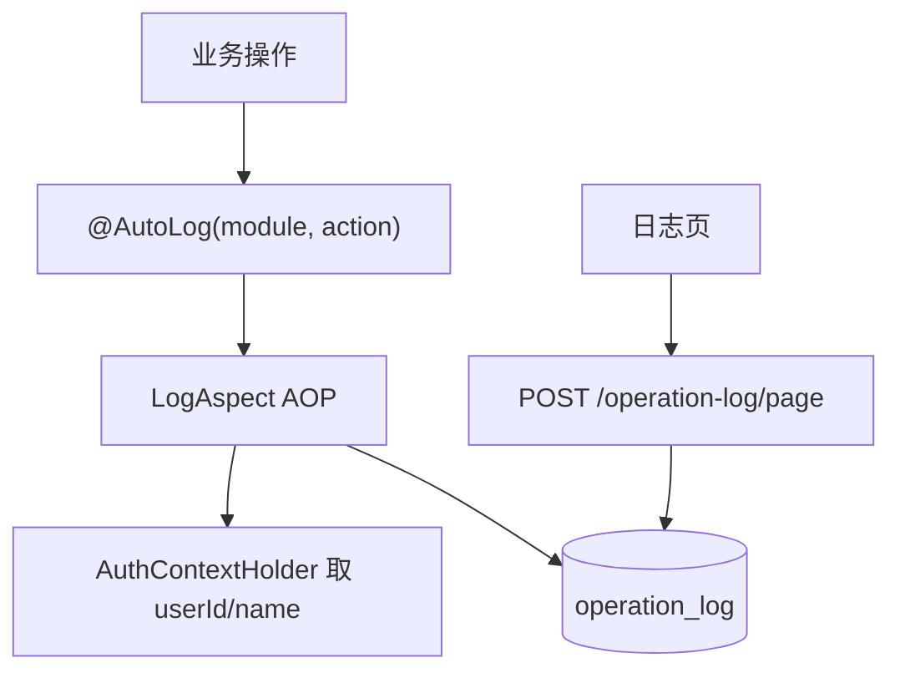

# 功能开发文档 · 16·操作日志

> 项目：宠老板复刻 · 里程碑：M2（F-024，P1）
> 作用：记录关键业务操作留痕（谁、何时、对什么做了什么），供审计与排查。

---

## 1. 功能概述

实现**操作日志记录与查询**：通过注解或 AOP 拦截关键操作写入 `operation_log`，管理端按操作人/时间/类型检索。

- 核心产出：`@AutoLog` 注解、日志切面、日志查询接口、日志页。
- 前置：M0 脚手架、F-003 公共组件（AuthContextHolder 取操作人）。

---

## 2. 数据流



---

## 3. 需求明细

| 编号 | 功能点 | 说明 | 优先级 |
|------|--------|------|--------|
| R-01 | 自动记录 | 注解式 AOP 记录 | P1 |
| R-02 | 记录内容 | 操作人/模块/动作/参数摘要/IP/时间 | P1 |
| R-03 | 查询列表 | 按操作人/模块/时间过滤 | P1 |
| R-04 | 租户隔离 | 仅本店日志 | P1 |

---

## 4. 表结构 `operation_log`
| 字段 | 类型 | 说明 |
|------|------|------|
| id | bigint PK | 主键 |
| shop_id | bigint | 租户 |
| user_id | bigint | 操作人 |
| user_name | varchar | 操作人姓名 |
| module | varchar | 模块 |
| action | varchar | 动作 |
| params | text | 关键参数(脱敏) |
| ip | varchar | 来源 IP |
| create_time | datetime | 时间 |

---

## 5. 实现要点

### 5.1 注解
```java
@Retention(RUNTIME) @Target(METHOD)
public @interface AutoLog {
    String module();
    String action();
}
```

### 5.2 切面 `LogAspect`
- 环绕：方法前记录参数摘要、成功/失败状态；`@Around` 捕获异常写入失败日志（不阻断业务）。
- 采集 `AuthContextHolder` 的 userId/name；IP 从请求头 `X-Forwarded-For`。
- **脱敏**：密码/手机号等敏感参数打码后入库。

### 5.3 查询接口
- `POST /api/v1/operation-log/page`：按 shop_id 过滤 + 操作人/模块/时间范围。

---

## 6. 前端设计
- `pages/system/OperationLog.tsx`：搜索条件 + Table + 时间筛选。

---

## 7. 代码落点
```
pets-common/annotation/AutoLog.java
pets-common/aspect/LogAspect.java
system-service/controller/OperationLogController.java
  service/OperationLogService.java / mapper/OperationLogMapper.java
frontend/src/pages/system/OperationLog.tsx
```

---

## 8. 开发任务清单

- [ ] `AutoLog` 注解 + `LogAspect` 切面（成功/失败/脱敏/IP）。
- [ ] 建表 `operation_log`。
- [ ] 操作日志查询接口。
- [ ] 给员工管理/角色等关键接口加 `@AutoLog`。
- [ ] 前端日志页。

---

## 9. 验收标准（DoD）

- [ ] 标记了 `@AutoLog` 的操作自动落日志，含操作人与时间。
- [ ] 参数中敏感信息脱敏。
- [ ] 查询支持操作人/模块/时间过滤，租户隔离正确。