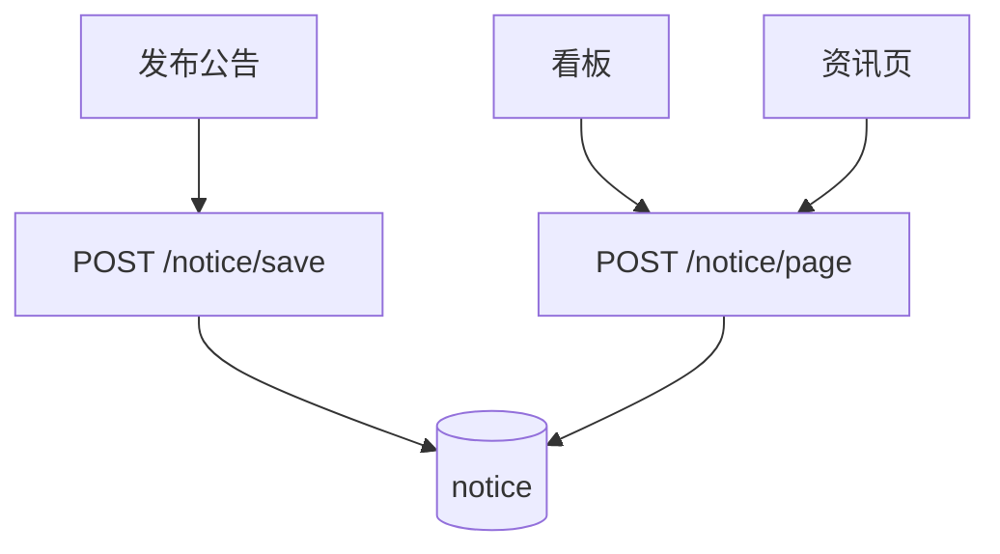

# 功能开发文档 · 17·公告与行业资讯

> 项目：宠老板复刻 · 里程碑：M2（F-025，P2）
> 作用：展示系统公告通知与行业资讯，供前台看板与公告列表消费。

---

## 1. 功能概述

提供**公告通知与行业资讯**的内容维护与展示：`notice` 表存储记录，支持发布/列表查询；看板与公告页消费。

- 核心产出：公告 CRUD（或多为系统发布，仅查询）、前台展示。
- 前置：M0 脚手架、`notice` 表。

---

## 2. 数据流



---

## 3. 需求明细

| 编号 | 功能点 | 说明 | 优先级 |
|------|--------|------|--------|
| R-01 | 公告列表 | 类型(公告/资讯)+标题+时间 | P2 |
| R-02 | 公告详情 | 内容查看 | P2 |
| R-03 | 发布公告 | 系统侧维护 | P2 |
| R-04 | 看板引用 | 复用 F-020 看板公告区 | P1 |

---

## 4. 表结构 `notice`
| 字段 | 类型 | 说明 |
|------|------|------|
| id | bigint PK | 主键 |
| shop_id | bigint | 租户(0=公共) |
| type | tinyint | 1 公告 2 资讯 |
| title | varchar | 标题 |
| content | text | 内容 |
| status | tinyint | 0 下架 1 上架 |
| create_time | datetime | 发布时间 |

---

## 5. 接口设计
- `POST /api/v1/notice/page`：类型+关键字+分页，仅返回上架。
- `POST /api/v1/notice/detail`：id 详情。

---

## 6. 前端设计
- 看板公告区（F-020 已含）；独立`pages/shop/Notice.tsx` 可看全部。

---

## 7. 代码落点
```
shop-service/controller/NoticeController.java
  service/NoticeService.java / mapper/NoticeMapper.java
frontend/src/api/notice.ts
```

---

## 8. 开发任务清单

- [ ] 建表 `notice` + 初始公告数据。
- [ ] `NoticeService`：page/detail。
- [ ] 公告接口对接看板与公告页。
- [ ] 自测：只展示上架、类型过滤。

---

## 9. 验收标准（DoD）

- [ ] 公告列表仅显示上架项，详情可读。
- [ ] 看板公告区复用正常数据。