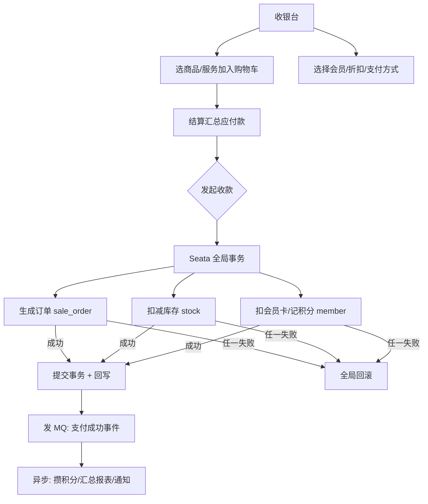

# 功能开发文档 · 18·收银台

> 项目：宠老板复刻 · 里程碑：M3（F-030，P0 · 核心）
> 作用：门店前台收款核心入口—选品/选会员/打折/收款，跨「订单+库存+会员」强一致落账，是本项目最具复杂度的教学点。

---

## 1. 功能概述

实现**收银台**：收银员点选商品/服务、选择会员、应用折扣，发起收款。下单需保证**订单落库、库存扣减、会员积分/卡扣款**的一致（跨 trade + stock + member 三服务）。

- 核心产出：购物车、结算、收款下单接口、前端收银页。
- 前置：M1 鉴权、M4 商品/库存数据可读、M5 会员可读、Redis 号段、RocketMQ、Seata。
- 一致策略：实时强一致走 **Seata AT**；库存/积分异步仍可走 **RocketMQ 事务消息**（见 4.2 备注）。

---

## 2. 业务流程图



---

## 3. 需求明细

| 编号 | 功能点 | 说明 | 优先级 |
|------|--------|------|--------|
| R-01 | 购物车选品 | 商品/服务加入、改数量、减 | P0 |
| R-02 | 选会员 | 关联会员，应用充值卡/折扣 | P0 |
| R-03 | 折扣/金额 | 条码/手动折扣、应收实收 | P0 |
| R-04 | 收款方式 | 现金/微信/支付宝/刷卡 | P0 |
| R-05 | 多服务原子下单 | Seata 事务跨服务 | P0 |
| R-06 | 快速收银(条码) | 扫码直接结算 | P1 |

---

## 4. 接口与一致设计

### 4.1 POST /api/v1/trade/checkout
```json
// 请求
{ "memberId":100,"payType":"cash","discount":0.9,
  "items":[ {"goodsId":1,"skuId":11,"qty":2,"price":9.9},
            {"serviceId":20,"qty":1,"price":39 } ] }
// 响应
{ "code":0, "data":{ "orderId":90001, "orderNo":"P202609110001",
                     "total":58.8, "payable":52.92, "actualReceived":52.92 } }
```
- 幂等：前端传业务幂等键，防重复下单（订单号用 Redis 号段）。
- 库存校验：下单前预占，失败明确提示缺货。

### 4.2 事务策略（教学要点）
- **Seata AT**：`@GlobalTransactional` 包裹 checkout，跨 trade/stock/member 数据源统一提交/回滚。
- **RocketMQ 事务消息**（备选）：订单本地入库成功后再提交消息，异步扣库、记积分——收益是主流程非阻塞，但需补偿对账。

> 教学建议：先实现 Seata AT 保证课上「直观正确」，再扩展事务消息讲解最终一致。

---

## 5. 表结构（核心）

### 5.1 销售订单 `sale_order`
| 字段 | 类型 | 说明 |
|------|------|------|
| id | bigint PK | Redis 号段 |
| shop_id | bigint | 租户 |
| order_no | varchar | 单号(规则见 F-031) |
| member_id | bigint | 会员(可空) |
| clerk_id | bigint | 收银员 |
| total / payable / actual | decimal | 金额 |
| pay_type | varchar | 支付方式 |
| status | tinyint | 待付款/已完成/已退款 |
| create_time | datetime | |

### 5.2 流水 `payment`（见 F-033）

---

## 6. 前端设计（收银台）
- `pages/cashier/index.tsx`：左商品/服务选择（可搜索）、中间购物车、右侧会员区+结算区。快捷键盘、条码输入。

---

## 7. 代码落点
```
trade-service/controller/CheckoutController.java
  service/CheckoutService.java (Seata 事务入口)
  dto/CheckoutReq.java / CheckoutResult.java
  mapper/SaleOrderMapper.java / PaymentMapper.java
  producer/OrderEventProducer.java (MQ 事务消息)
frontend/src/pages/cashier/index.tsx + api/cashier.ts
```

---

## 8. 开发任务清单

- [ ] `CheckoutService`：校验库存→生成订单→(Seata)扣库/扣款→回写。
- [ ] `CheckoutController` + 幂等键。
- [ ] 对接 MQ：下单成功发 `order_pay_success` 事件。
- [ ] 前端收银台（选品/会员/折扣/结算）。
- [ ] 自测：成功下单各表一致；缺货/金额不足被拒；并发同商品不超卖。

---

## 9. 验收标准（DoD）

- [ ] 正常收款生成订单、扣库存、记会员流水，三者状态一致。
- [ ] 模拟库存不足/会员卡余额不足时全局回滚，无脏数据。
- [ ] 同一收银请求重复提交不重复下单（幂等）。
- [ ] 前端收银流程完整可用（选品→结算→收款成功）。