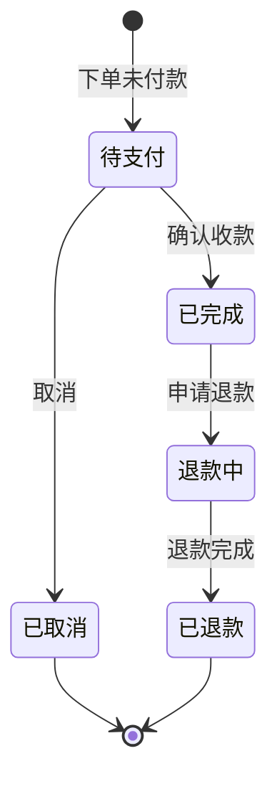

# 功能开发文档 · 19·订单管理

> 项目：宠老板复刻 · 里程碑：M3（F-031，P0）
> 作用：销售订单的查询、详情、退款/取消等后台管理，作为收银后的订单生命周期管理入口。

---

## 1. 功能概述

实现**订单管理**：订单分页查询（状态/时间/收银员过滤）、订单详情（商品明细+支付流水+折扣）、取消/退款操作。订单数据源自 F-030 收银台。

- 核心产出：订单列表、详情、取消/退款接口、订单管理页。
- 前置：F-030 收银台（sale_order/order_item）、Redis 号段、RocketMQ。

---

## 2. 订单状态机



---

## 3. 需求明细

| 编号 | 功能点 | 说明 | 优先级 |
|------|--------|------|--------|
| R-01 | 订单分页查询 | 状态/时间/收银员/单号过滤 | P0 |
| R-02 | 订单详情 | 明细+流水+折扣 | P0 |
| R-03 | 取消订单 | 待支付可取消，回滚库存 | P1 |
| R-04 | 退款 | 完成后退款，回退会员/库存 | P1 |
| R-05 | 打印小票 | 收银小票/电子小票 | P2 |

---

## 4. 接口设计

### 4.1 POST /api/v1/trade/order/page
```json
// 请求 { "page_num":1,"page_size":20,"status":"complete","start":"2026-09-01","end":"2026-09-18","clerkId":1 }
// 响应 { code:0, data:[{orderNo,memberName,total,status,createTime}], page:{...} }
```

### 4.2 POST /api/v1/trade/order/detail
```json
// 请求 { "orderId":90001 }
// 响应 data:{ orderNo,total,payable,payType,status,
//            items:[{goodsName,qty,price,amount}],
//            payments:[{payType,amount,time}] }
```

### 4.3 POST /api/v1/trade/order/cancel
- 仅「待支付」可取消；取消后回滚库存（Seata 或补偿消息）。

---

## 5. 表结构补充 `order_item`
| 字段 | 类型 | 说明 |
|------|------|------|
| id | bigint PK | 主键 |
| order_id | bigint | 订单 |
| goods_id / service_id | bigint | 商品或服务 |
| goods_name | varchar | 快照 |
| qty | int | 数量 |
| price / amount | decimal | 单价/金额 |

---

## 6. 前端设计
- `pages/order/index.tsx`：筛选工具栏 + Table + 详情抽屉 + 取消/退款按钮（按状态可用）。

---

## 7. 代码落点
```
trade-service/controller/OrderController.java
  service/OrderService.java (page/detail/cancel/refund)
  dto/OrderPageReq.java / OrderDetailVO.java / mapper/OrderItemMapper.java
frontend/src/pages/order/index.tsx + api/order.ts
```

---

## 8. 开发任务清单

- [ ] `OrderService`：分页/详情取数。
- [ ] 取消/退款逻辑（校验状态、回滚库存/会员）。
- [ ] 前端订单管理页（列表/详情/操作）。
- [ ] 对接 F-030 订单数据。
- [ ] 自测：状态过滤、取消/退款幂等与状态流转正确。

---

## 9. 验收标准（DoD）

- [ ] 订单列表分页与多重过滤正确，详情含明细与流水。
- [ ] 待支付订单可取消且库存回滚；已完成可退款且回退会员。
- [ ] 状态非法操作被拒绝并有明确提示。