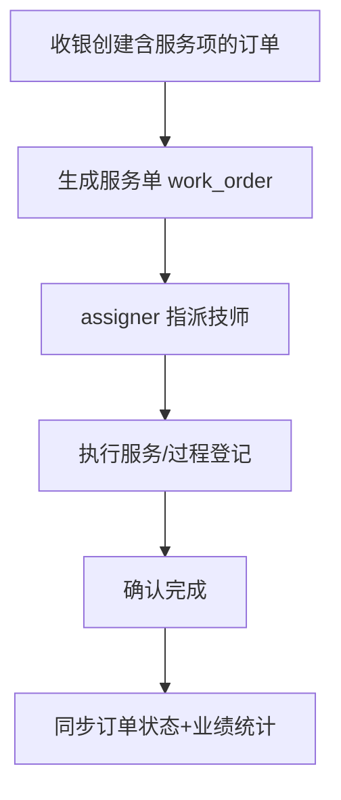

# 功能开发文档 · 20·订单服务（服务单）

> 项目：宠老板复刻 · 里程碑：M3（F-032，P1）
> 作用：针对宠物服务类订单（美容/清洗/拍照等服务单），创建服务单、执行登记、确认完成，统计服务业绩。

---

## 1. 功能概述

管理**服务订单(from F-030 的服务项)**的后续执行：开服务单、登记完成、服务明细，支持美容等场景的流程登记（过程中照片/备注）。可与收银联动的子流程。

- 核心产出：服务单创建、完成登记、列表与详情。
- 前置：F-030 收银（服务项入单）、M4 服务项目、`order_item`。

---

## 2. 服务单流程



---

## 3. 需求明细

| 编号 | 功能点 | 说明 | 优先级 |
|------|--------|------|--------|
| R-01 | 服务单生成 | 由服务项订单派生 | P1 |
| R-02 | 指派/登记 | 技师、过程备注/照片 | P1 |
| R-03 | 完成确认 | 标记完成，联动业绩 | P1 |
| R-04 | 服务单查询 | 列表/详情/状态 | P1 |

---

## 4. 表结构 `work_order`
| 字段 | 类型 | 说明 |
|------|------|------|
| id | bigint PK | 主键 |
| order_id | bigint | 来源订单 |
| service_id | bigint | 服务项目 |
| clerk_id | bigint | 技师 |
| status | tinyint | 待服务/服务中/已完成 |
| remark / pics | text | 备注/照片(JSON) |
| create_time / finish_time | datetime | |

---

## 5. 接口设计
- `POST /api/v1/trade/order-service/page`：服务单列表。
- `POST /api/v1/trade/order-service/comeplete`：完成登记，回写订单状态并计入员工业绩。

---

## 6. 前端设计
- `pages/order/OrderService.tsx`：服务单列表 + 详情 + 完成操作。

---

## 7. 代码落点
```
trade-service/controller/OrderServiceController.java
  service/OrderServiceService.java / mapper/WorkOrderMapper.java
frontend/src/pages/order/OrderService.tsx
```

---

## 8. 开发任务清单

- [ ] 收银下单含服务项时生成 `work_order`。
- [ ] 服务单指派/完成登记接口。
- [ ] 完成后回写订单状态 + 业绩(整表 cl 或 report 预留)。
- [ ] 前端服务单列表/详情。
- [ ] 自测：含服务项下单即派生服务单，完成流转正确。

---

## 9. 验收标准（DoD）

- [ ] 含服务项的订单自动生成服务单。
- [ ] 完成登记后订单与服务单状态正确，业绩可统计。
- [ ] 服务单列表与详情展示完整。