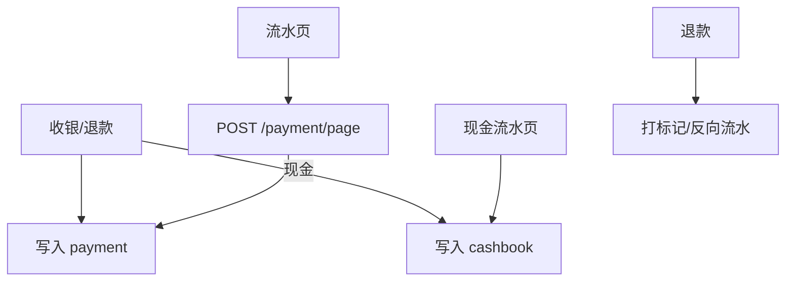

# 功能开发文档 · 21·支付与流水

> 项目：宠老板复刻 · 里程碑：M3（F-033，P1）
> 作用：管理收款支付方式与收银流水（payment 表），提供现金流水（cashbook）对账，支撑退款联动。

---

## 1. 功能概述

实现**支付记录与收银流水**：收银时按支付方式写入 `payment` 流水，现金收付记入 `cashbook`；支持流水查询与退款流水回冲。

- 核心产出：支付流水、现金流水接口、流水查询页。
- 前置：F-030 收银、F-031 订单。

---

## 2. 数据流



---

## 3. 需求明细

| 编号 | 功能点 | 说明 | 优先级 |
|------|--------|------|--------|
| R-01 | 支付流水记录 | 支付方式/金额/订单/时间 | P0 |
| R-02 | 现金流水 | 现金收/支，如收款/找零/退款 | P1 |
| R-03 | 流水查询 | 按订单/方式/时间过滤 | P1 |
| R-04 | 退款流水 | 退款回冲记录 | P1 |

---

## 4. 表结构

### 4.1 支付流水 `payment`
| 字段 | 类型 | 说明 |
|------|------|------|
| id | bigint PK | 主键 |
| order_id | bigint | 订单 |
| pay_type | varchar | cash/wechat/alipay/... |
| amount | decimal | 金额 |
| status | tinyint | 1 成功 0 失败 |
| biz_no | varchar | 外部流水号 |
| create_time | datetime | |

### 4.2 现金流水 `cashbook`
| 字段 | 类型 | 说明 |
|------|------|------|
| id | bigint PK | 主键 |
| shop_id | bigint | 租户 |
| type | tinyint | 收入/支出 |
| amount | decimal | 金额 |
| biz_type | varchar | 收款/找零/提现/退款 |
| order_id | bigint | 关联订单 |
| clerk_id | bigint | 经办人 |
| memo | varchar | 备注 |
| create_time | datetime | |

---

## 5. 接口设计
- `POST /api/v1/trade/payment/page`：流水分页查询。
- `POST /api/v1/trade/cashbook/page`：现金流水分页。

---

## 6. 前端设计
- `pages/order/Payment.tsx`：流水列表 + 筛选。

---

## 7. 代码落点
```
trade-service/controller/PaymentController.java
  service/PaymentService.java / mapper/PaymentMapper.java / CashbookMapper.java
frontend/src/pages/order/Payment.tsx + api/payment.ts
```

---

## 8. 开发任务清单

- [ ] 收银时写入 `payment`；现金收付写 `cashbook`。
- [ ] 退款生成反向流水。
- [ ] 两个流水查询接口。
- [ ] 前端流水页。
- [ ] 自测：下单生成正确流水、退款回冲、对账总数一致。

---

## 9. 验收标准（DoD）

- [ ] 每笔收款生成对应支付流水，现金同步入现金流水。
- [ ] 退款回冲后流水与订单金额一致。
- [ ] 流水查询过滤正确。