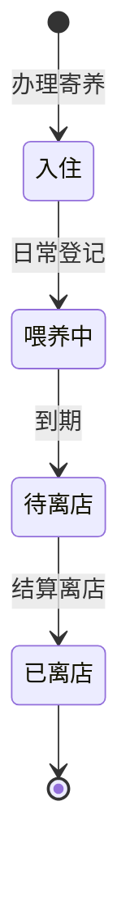

# 功能开发文档 · 22·寄养管理

> 项目：宠老板复刻 · 里程碑：M3（F-034，P2）
> 作用：宠物寄养业务办理：登记入住/喂养/接宠离店，按天计费，关联会员与支付。

---

## 1. 功能概述

支持**寄养办理**：建立寄养单（宠物、入住/离店时间、按天价格、寄养笼位），入住/离店状态流转，离店结算费用并入订单支付。

- 核心产出：寄养单创建、状态流转、结算。
- 前置：F-030 收银、F-033 支付、M5 会员。

---

## 2. 寄养状态机



---

## 3. 需求明细

| 编号 | 功能点 | 说明 | 优先级 |
|------|--------|------|--------|
| R-01 | 寄养单创建 | 宠物/日期/价格/笼位 | P2 |
| R-02 | 日常登记 | 喂养/健康备注 | P2 |
| R-03 | 离店结算 | 按天计费并入订单 | P2 |
| R-04 | 寄养列表 | 进行中/历史 | P2 |

---

## 4. 表结构 `foster`
| 字段 | 类型 | 说明 |
|------|------|------|
| id | bigint PK | 主键 |
| shop_id | bigint | 租户 |
| member_id | bigint | 会员 |
| pet_name | varchar | 宠物名 |
| cage_no | varchar | 笼位 |
| checkin_time | datetime | 入住 |
| checkout_time | datetime | 预计/实际离店 |
| price_day | decimal | 日价 |
| status | tinyint | 入住/喂养/待离店/已离店 |
| remark | varchar | 备注 |

---

## 5. 接口设计
- `POST /api/v1/trade/foster/create`：入住建单。
- `POST /api/v1/trade/foster/feed`：日常登记。
- `POST /api/v1/trade/foster/checkout`：离店结算（生成费用+支付，复用收银）。

---

## 6. 前端设计
- `pages/order/Foster.tsx`：寄养列表 + 办理 + 状态操作。

---

## 7. 代码落点
```
trade-service/controller/FosterController.java
  service/FosterService.java / mapper/FosterMapper.java
frontend/src/pages/order/Foster.tsx
```

---

## 8. 开发任务清单

- [ ] 建表 `foster`。
- [ ] 办理/登记/离店结算接口。
- [ ] 离店联接收银产生订单+支付。
- [ ] 前端寄养页。
- [ ] 自测：状态流转、按天费用计算正确。

---

## 9. 验收标准（DoD）

- [ ] 寄养单可创建并流转状态。
- [ ] 离店按天计费并生成可支付订单。
- [ ] 寄养列表与操作正常。