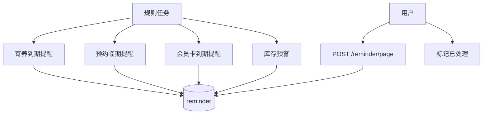

# 功能开发文档 · 23·提醒管理

> 项目：宠老板复刻 · 里程碑：M3（F-035，P2）
> 作用：管理待办提醒（如寄养到期、预约快至、会员卡到期），提供提醒列表，支撑看板「今日提醒」。

---

## 1. 功能概述

汇聚**业务提醒/待办**：寄养到期、预约临期、会员卡到期、库存预警等生成提醒记录，支持查看与处理标记，看板「今日提醒」读取。

- 核心产出：提醒生成规则、提醒列表、处理标记。
- 前置：F-034 寄养、M5 会员卡、M4 库存。

---

## 2. 提醒生成



---

## 3. 需求明细

| 编号 | 功能点 | 说明 | 优先级 |
|------|--------|------|--------|
| R-01 | 提醒列表 | 类型/标题/时间/状态 | P2 |
| R-02 | 生成来源 | 至少支持寄养到期/预约/卡到期 | P2 |
| R-03 | 处理标记 | 待办→已处理 | P2 |
| R-04 | 看板联动 | 今日提醒计数(F-020) | P1 |

---

## 4. 表结构 `reminder`
| 字段 | 类型 | 说明 |
|------|------|------|
| id | bigint PK | 主键 |
| shop_id | bigint | 租户 |
| biz_type | varchar | foster/appointment/card/stock |
| title | varchar | 标题 |
| biz_id | bigint | 关联业务 |
| remind_time | datetime | 提醒时间 |
| status | tinyint | 0 待办 1 已处理 |
| create_time | datetime | |

---

## 5. 接口设计
- `POST /api/v1/trade/reminder/page`：提醒分页（按 shop_id）。
- `POST /api/v1/trade/reminder/done`：标记处理。

---

## 6. 前端设计
- `pages/order/Reminder.tsx`：提醒列表 + 筛选 + 处理。

---

## 7. 代码落点
```
trade-service/controller/ReminderController.java
  service/ReminderService.java / mapper/ReminderMapper.java
  task/ReminderTask.java (定时生成, 或由业务落库时直接创建)
frontend/src/pages/order/Reminder.tsx
```

---

## 8. 开发任务清单

- [ ] 建表 `reminder`。
- [ ] 寄养到期/卡到期生成提醒（定时任务或业务触发）。
- [ ] 列表 + 处理接口。
- [ ] 前端提醒页 + 看板计数联动。
- [ ] 自测：到期生成提醒、处理状态正确。

---

## 9. 验收标准（DoD）

- [ ] 到期业务能生成提醒记录。
- [ ] 提醒可列表、可标记处理。
- [ ] 看板「今日提醒」计数一致。