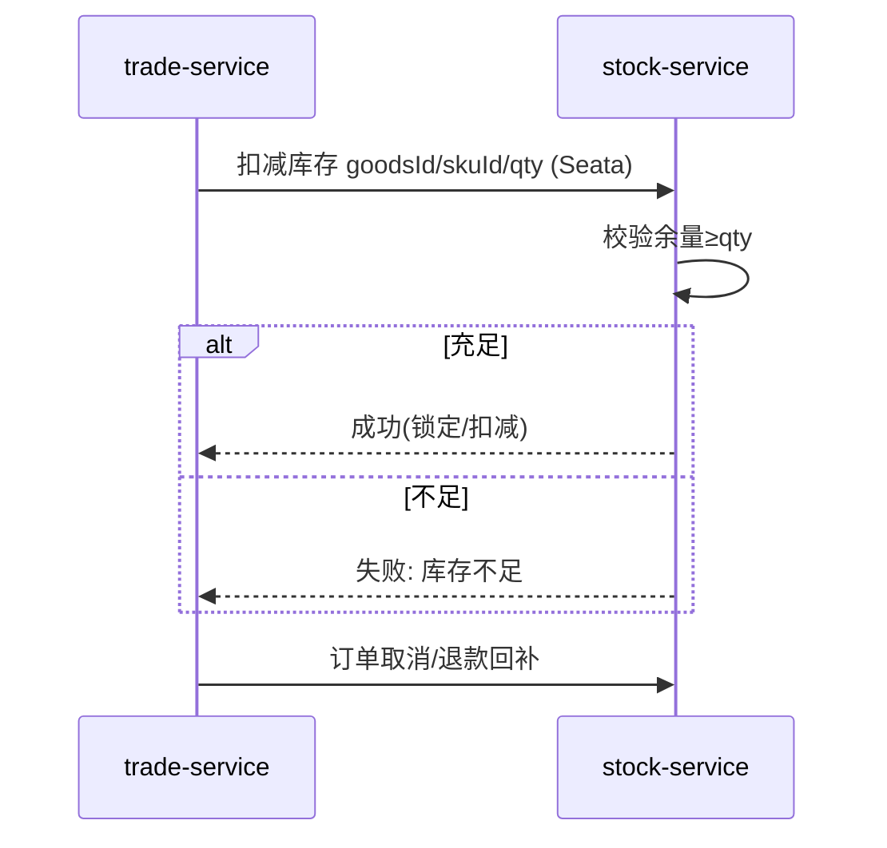

# 功能开发文档 · 26·库存管理

> 项目：宠老板复刻 · 里程碑：M4（F-043，P0）
> 作用：商品库存查询、预警、扣减/回补，作为收银下单扣库存的核心数据源（stock-service）。

---

## 1. 功能概述

实现**库存管理**：各商品/SKU 库存余量查询、低于预警线提示、安全扣减与回补（配合收银与出入库），支撑看板「库存不足」计数。

- 核心产出：库存查询、预警、扣减/回补接口、库存页。
- 前置：F-040 商品、M0、Seata（与收银联动扣库存）。

---

## 2. 库存扣减时序（收银联动）



---

## 3. 需求明细

| 编号 | 功能点 | 说明 | 优先级 |
|------|--------|------|--------|
| R-01 | 库存查询 | 商品/SKU 余量、列表 | P0 |
| R-02 | 预警提示 | 低于阈值标红/计数 | P0 |
| R-03 | 安全扣减 | 防超卖锁 | P0 |
| R-04 | 回补 | 取消/退款加回 | P1 |

---

## 4. 表结构 `stock`
| 字段 | 类型 | 说明 |
|------|------|------|
| id | bigint PK | 主键 |
| shop_id | bigint | 租户 |
| goods_id | bigint | 商品 |
| sku_id | bigint | 规格(0=无规格) |
| quantity | int | 当前库存 |
| warn_qty | int | 预警阈值 |
| update_time | datetime | 版本(乐观锁) |

---

## 5. 接口设计
- `POST /api/v1/stock/page`：库存列表 + 预警。
- `POST /api/v1/stock/deduct`：扣减（供收银 Seata 调用，乐观锁防超卖）。
- `POST /api/v1/stock/revert`：回补。

### 5.1 防超卖要点
```sql
UPDATE stock SET quantity = quantity - #{qty}, update_time=NOW()
WHERE goods_id=#{g} AND sku_id=#{s} AND quantity >= #{qty};
-- 影响行数=0 则库存不足
```

---

## 6. 前端设计
- `pages/stock/index.tsx`：库存表格（预警高亮）+ 调整入口。

---

## 7. 代码落点
```
stock-service/controller/StockController.java
  service/StockService.java (deduct/revert 供 feign/mq)
  mapper/StockMapper.java
frontend/src/pages/stock/index.tsx + api/stock.ts
```

---

## 8. 开发任务清单

- [ ] 建表 `stock`。
- [ ] `StockService.deduct/revert`（乐观锁防超卖）。
- [ ] 库存列表 + 预警。
- [ ] 收银下单对接扣减（Seata 同事务）。
- [ ] 前端库存页。
- [ ] 自测：并发扣减不超卖、回补正确、预警计数与看板一致。

---

## 9. 验收标准（DoD）

- [ ] 库存查询/预警正确，低于阈值高亮。
- [ ] 并发下单不超卖（余量不足拒绝）。
- [ ] 取消/退款回补库存准确。
- [ ] 看板「库存不足」计数与库存表一致。