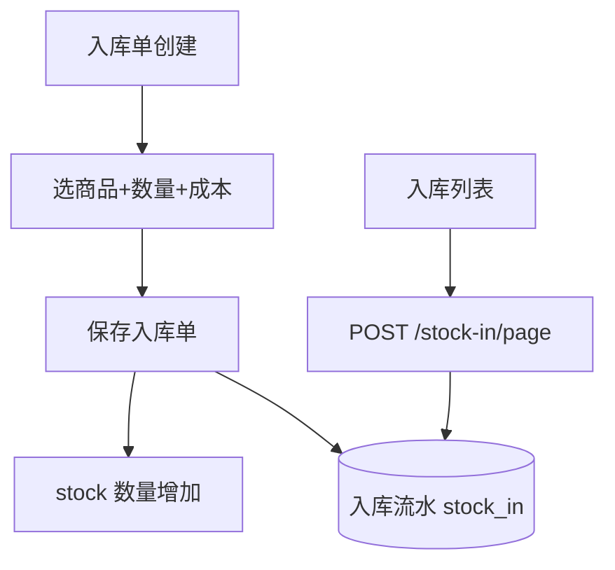

# 功能开发文档 · 28·入库管理

> 项目：宠老板复刻 · 里程碑：M4（F-044，P1）
> 作用：采购/进货入库单，入库增加库存并记账，形成供应商往来与进货成本。

---

## 1. 功能概述

实现**入库单**：录入入库商品/数量/成本/供应商，保存后增加 `stock` 余量并写入入库流水，可查询入库历史。

- 核心产出：入库单创建、库存入账、入库列表。
- 前置：M0、F-040 商品、F-043 库存。

---

## 2. 数据流



---

## 3. 需求明细

| 编号 | 功能点 | 说明 | 优先级 |
|------|--------|------|--------|
| R-01 | 创建入库单 | 多商品/数量/成本/供应商 | P1 |
| R-02 | 库存入账 | 提交即加库存 | P1 |
| R-03 | 入库流水 | 历史查询 | P1 |

---

## 4. 表结构

### 4.1 入库单 `stock_in`
| 字段 | 类型 | 说明 |
|------|------|------|
| id | bigint PK | 单号 |
| shop_id | bigint | 租户 |
| supplier_id | bigint | 供应商(可空) |
| total | decimal | 总成本 |
| clerk_id | bigint | 经办 |
| create_time | datetime | |
| status | tinyint | 已入库 |

### 4.2 入库明细 `stock_in_item`
| 字段 | 类型 | 说明 |
|------|------|------|
| id | bigint PK | 主键 |
| in_id | bigint | 入库单 |
| goods_id / sku_id | bigint | 商品 |
| qty | int | 数量 |
| cost | decimal | 成本 |

---

## 5. 接口设计
- `POST /api/v1/stock-in/create`：创建+入账（事务：写单 + 加 stock + 记流水）。
- `POST /api/v1/stock-in/page`：入库历史。

---

## 6. 前端设计
- `pages/stock/Inbound.tsx`：入库单表单（商品明细动态行）+ 历史列表。

---

## 7. 代码落点
```
stock-service/controller/StockInController.java
  service/StockInService.java / mapper/StockInMapper.java / StockInItemMapper.java
frontend/src/pages/stock/Inbound.tsx
```

---

## 8. 开发任务清单

- [ ] 建表 stock_in / stock_in_item。
- [ ] `StockInService.create`：单 + 库存入账 + 流水。
- [ ] 入库列表接口。
- [ ] 前端入库页。
- [ ] 自测：入库后库存增加、金额正确。

---

## 9. 验收标准（DoD）

- [ ] 入库提交后商品库存准确增加。
- [ ] 入库单与明细完整，历史可查。
- [ ] 库存调整仅在状态正常时生效。