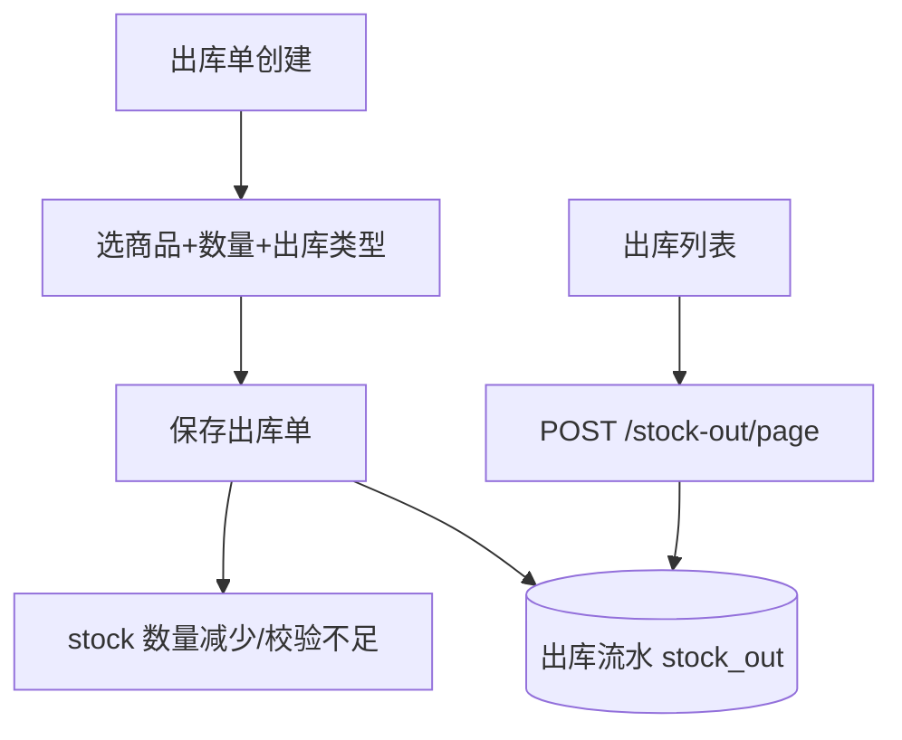

# 功能开发文档 · 29·出库管理

> 项目：宠老板复刻 · 里程碑：M4（F-045，P1）
> 作用：处理非销售类出库（退货给供应商、报损、其他领用/出库），减少库存并记账。

---

## 1. 功能概述

实现**出库单**：录入出库原因（退货/报损/领用）、商品/数量，保存后减少 `stock` 并写入出库流水。

- 核心产出：出库单创建、库存减少、出库列表。
- 前置：M0、F-040 商品、F-043 库存。

---

## 2. 数据流



---

## 3. 需求明细

| 编号 | 功能点 | 说明 | 优先级 |
|------|--------|------|--------|
| R-01 | 创建出库单 | 类型/商品/数量 | P1 |
| R-02 | 库存减少 | 校验余量后扣减 | P1 |
| R-03 | 出库流水 | 历史查询 | P1 |

---

## 4. 表结构
- `stock_out` / `stock_out_item`，结构与 `stock_in` 对称，仅多 `out_type`（退货/报损/领用）。

---

## 5. 接口设计
- `POST /api/v1/stock-out/create`：校验库存→扣减→记流水。
- `POST /api/v1/stock-out/page`：出库历史。

---

## 6. 前端设计
- `pages/stock/Outbound.tsx`：出库单表单 + 历史列表。

---

## 7. 代码落点
```
stock-service/controller/StockOutController.java
  service/StockOutService.java / mapper/StockOutMapper.java
frontend/src/pages/stock/Outbound.tsx
```

---

## 8. 开发任务清单

- [ ] 建表 stock_out / stock_out_item。
- [ ] `StockOutService.create`：校验+扣减+流水。
- [ ] 出库列表接口。
- [ ] 前端出库页。
- [ ] 自测：出库减库存、超量拒绝。

---

## 9. 验收标准（DoD）

- [ ] 出库扣减库存，余量不足时拒绝且有提示。
- [ ] 出库单与流水完整，历史可查。