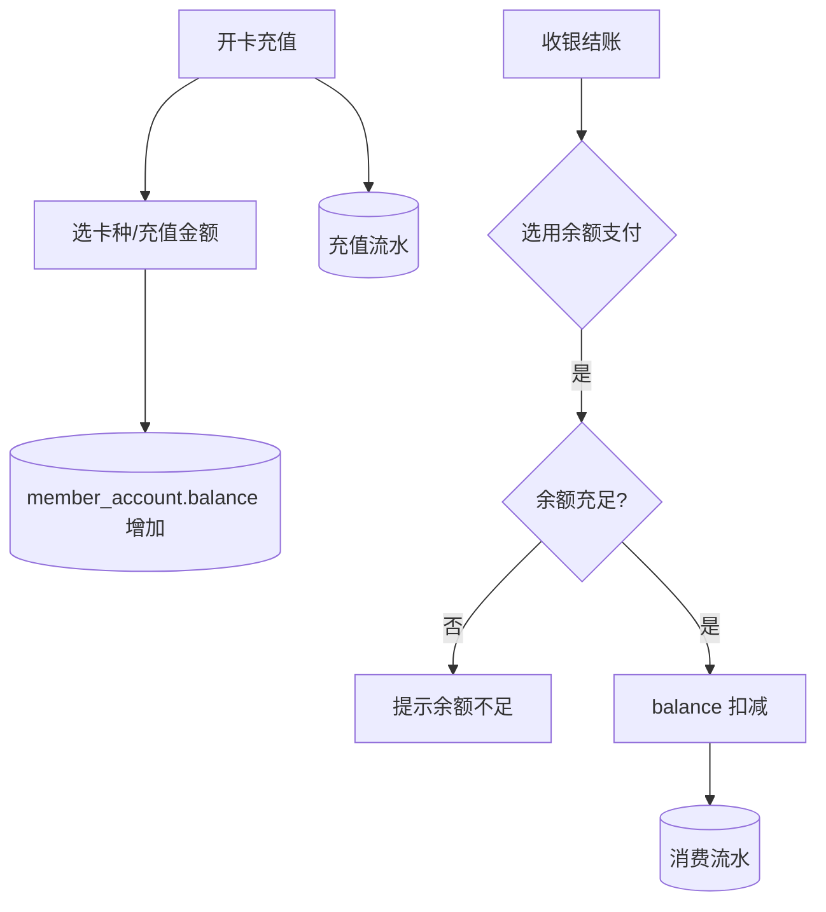

# 功能开发文档 · 31·会员卡 / 充值卡

> 项目：宠老板复刻 · 里程碑：M5（F-051，P0）
> 作用：会员充值卡管理，支持办卡、充值、余额扣费（收银结账），产生会员余额账户变动。

---

## 1. 功能概述

管理**会员卡（充值卡）**：设置卡种/规则，为会员开卡并充值，收银结账用余额抵扣，管理充值/消费流水与卡到期。

- 核心产出：卡种规则、开卡充值、余额扣减（收银联动）、卡的流水。
- 前置：F-050 会员/账户、F-030 收银、Redis 号段。

---

## 2. 充值与扣费流程



---

## 3. 需求明细

| 编号 | 功能点 | 说明 | 优先级 |
|------|--------|------|--------|
| R-01 | 卡种规则 | 面额/折扣/有效期 | P0 |
| R-02 | 开卡充值 | 充值入会员余额 | P0 |
| R-03 | 余额扣费 | 收银用余额/卡支付 | P0 |
| R-04 | 卡流水 | 充值/消费记录 | P1 |

---

## 4. 表结构

### 4.1 卡种 `card_type`
| 字段 | 类型 | 说明 |
|------|------|------|
| id | bigint PK | 主键 |
| shop_id | bigint | 租户 |
| name | varchar | 卡名 |
| face_value / discount | decimal | 面额/折扣 |
| valid_days | int | 有效期(天) |

### 4.2 会员卡 `member_card`
| 字段 | 类型 | 说明 |
|------|------|------|
| id | bigint PK | 主键 |
| member_id | bigint | 会员 |
| card_type_id | bigint | 卡种 |
| balance | decimal | 余额 |
| expire_time | datetime | 到期 |

### 4.3 账户流水 `member_account_log`
| 字段 | 类型 | 说明 |
|------|------|------|
| id | bigint PK | 主键 |
| member_id | bigint | 会员 |
| type | tinyint | 1 充值 2 消费 3 退款 |
| amount | decimal | 变动额(+/-) |
| order_id | bigint | 关联订单 |
| create_time | datetime | |

---

## 5. 接口设计
- `POST /api/v1/member/card-type/save`：卡种。
- `POST /api/v1/member/card/recharge`：开卡充值（入余额 + 记流水）。
- `POST /api/v1/member/account/deduct`：余额扣费（供收银 Seata 调用，防透支）。

---

## 6. 前端设计
- `pages/member/Card.tsx`：卡种设置 + 会员开卡充值 + 卡流水。

---

## 7. 代码落点
```
member-service/controller/CardController.java / AccountController.java
  service/CardService.java / AccountService.java / mapper/ MemberCardMapper.java / CardTypeMapper.java
frontend/src/pages/member/Card.tsx + api/card.ts
```

---

## 8. 开发任务清单

- [ ] 建表 card_type / member_card / member_account_log。
- [ ] 卡种管理与开卡充值（入余额 + 流水）。
- [ ] 余额扣费接口（供收银 Seata）防透支。
- [ ] 收银结账接入余额支付。
- [ ] 前端会员卡页。
- [ ] 自测：充值入账、扣费流水、余额不足拒绝。

---

## 9. 验收标准（DoD）

- [ ] 开卡充值后会员余额正确入账并记流水。
- [ ] 收银用余额支付正确扣减，余额不足被拒。
- [ ] 充值/消费流水可查，对账一致。