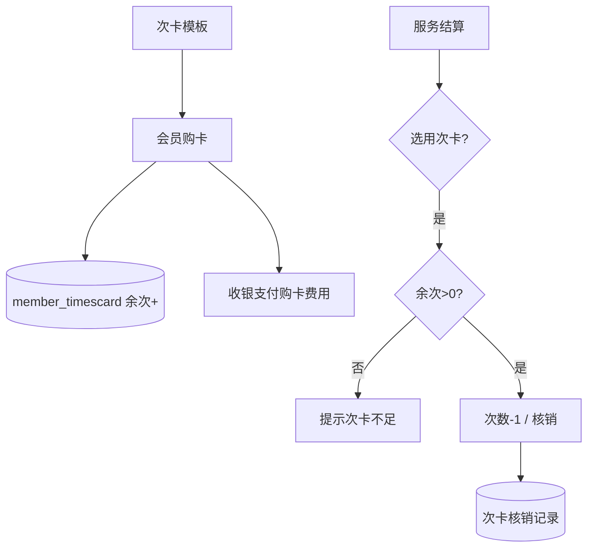

# 功能开发文档 · 32·次卡管理

> 项目：宠老板复刻 · 里程碑：M5（F-052，P0）
> 作用：次卡（计次服务卡）管理，如「美容 10 次卡」，购卡计次、使用核销，绑定服务项目（F-041）。

---

## 1. 功能概述

管理**次卡**：设置次卡模板（绑定服务+次数+价格），会员购卡计次入账，服务结算时核销次数，支持查询余次。

- 核心产出：次卡模板、购卡、次卡核销、余次查询。
- 前置：F-041 服务、F-050 会员、M3 收银联动。

---

## 2. 购卡与核销流程



---

## 3. 需求明细

| 编号 | 功能点 | 说明 | 优先级 |
|------|--------|------|--------|
| R-01 | 次卡模板 | 服务+次数+售价 | P0 |
| R-02 | 购卡 | 付费计次入账 | P0 |
| R-03 | 核销 | 服务结算扣次 | P0 |
| R-04 | 余次/记录 | 余次查询、使用记录 | P1 |

---

## 4. 表结构

### 4.1 模板 `timescard_template`
| 字段 | 类型 | 说明 |
|------|------|------|
| id | bigint PK | 主键 |
| shop_id | bigint | 租户 |
| name | varchar | 模板名 |
| service_id | bigint | 绑定服务 |
| times | int | 次数 |
| price | decimal | 售价 |

### 4.2 会员次卡 `member_timescard`
| 字段 | 类型 | 说明 |
|------|------|------|
| id | bigint PK | 主键 |
| member_id | bigint | 会员 |
| template_id | bigint | 模板 |
| remain_times | int | 剩余次数 |
| expire_time | datetime | 到期 |

---

## 5. 接口设计
- `POST /api/v1/member/timescard-template/save`：模板。
- `POST /api/v1/member/timescard/buy`：购卡（付费用收银，计次入账）。
- `POST /api/v1/member/timescard/consume`：核销一次（供收银）。

---

## 6. 前端设计
- `pages/member/TimesCard.tsx`：模板管理 + 会员次卡购买 + 核销记录。

---

## 7. 代码落点
```
member-service/controller/TimesCardController.java
  service/TimesCardService.java / mapper/TimesCardTemplateMapper.java / MemberTimesCardMapper.java
frontend/src/pages/member/TimesCard.tsx
```

---

## 8. 开发任务清单

- [ ] 建表 template / member_timescard。
- [ ] 模板管理 + 购卡 + 核销接口。
- [ ] 收银服务结算接入次卡核销（F-041 服务）。
- [ ] 前端次卡页。
- [ ] 自测：购卡计次、核销扣次、余次不足拒绝。

---

## 9. 验收标准（DoD）

- [ ] 购卡后余次正确入账。
- [ ] 服务结算可核销，余次不足被拒。
- [ ] 余次与核销记录可查。