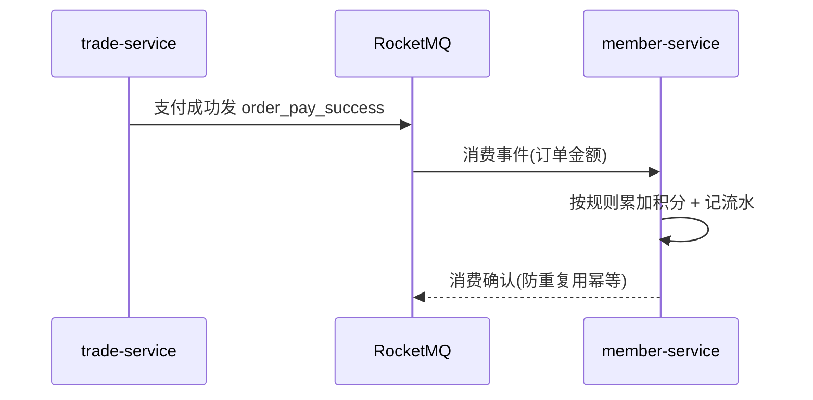

# 功能开发文档 · 33·会员积分

> 项目：宠老板复刻 · 里程碑：M5（F-053，P1）
> 作用：会员积分获取与消费，收银支付后按规则得积分，可用积分抵现/兑换，产生积分流水。

---

## 1. 功能概述

实现**会员积分**：配置得/兑积分规则（按消费金额）、支付后累计积分、收银用积分抵现、积分流水查询。**消费得积分走 RocketMQ 异步**，体现最终一致。

- 核心产出：积分规则、积分累加（MQ 消费）、积分抵现、积分流水。
- 前置：F-050 会员账户、F-030 收银、RocketMQ。

---

## 2. 积分累加流程（MQ 最终一致）



---

## 3. 需求明细

| 编号 | 功能点 | 说明 | 优先级 |
|------|--------|------|--------|
| R-01 | 积分规则 | 消费=积分比率/开关 | P1 |
| R-02 | 消费得积分 | MQ 异步累加 | P1 |
| R-03 | 积分抵现 | 收银按比例抵金额 | P1 |
| R-04 | 积分流水 | 获/抵记录 | P1 |

---

## 4. 表结构
- 积分余额存 `member_account.points`。
- 流水复用 `member_account_log`（type 3 积分得 / type 4 积分抵）。
- 规则存 `sys_param`（group=points：rate、enable、offset 金额）。

---

## 5. 接口设计
- `POST /api/v1/member/points/rule/save`：规则（落 sys_param）。
- MQ 消费：`order_pay_success` → 累加积分（幂等：按 order_id+member 校验）。
- `POST /api/v1/member/points/deduct`：积分抵现（供收银）。

---

## 6. 前端设计
- `pages/member/Points.tsx`：规则设置 + 积分流水。

---

## 7. 代码落点
```
member-service/consumer/PointsConsumer.java (RocketMQ)
  service/PointsService.java / mapper/MemberAccountMapper.java
frontend/src/pages/member/Points.tsx
```

---

## 8. 开发任务清单

- [ ] 配置积分规则（ratio/rate）。
- [ ] `PointsConsumer` 消费 MQ 累加积分（幂等）。
- [ ] 积分抵现接口。
- [ ] 收银接入加分与抵现。
- [ ] 前端积分页。
- [ ] 自测：支付后异步得分、抵现生效、幂等不重复加分。

---

## 9. 验收标准（DoD）

- [ ] 支付完成最终能准确累加积分（异步不丢不重）。
- [ ] 积分抵现正确扣减可用积分。
- [ ] 积分流水完整可查。