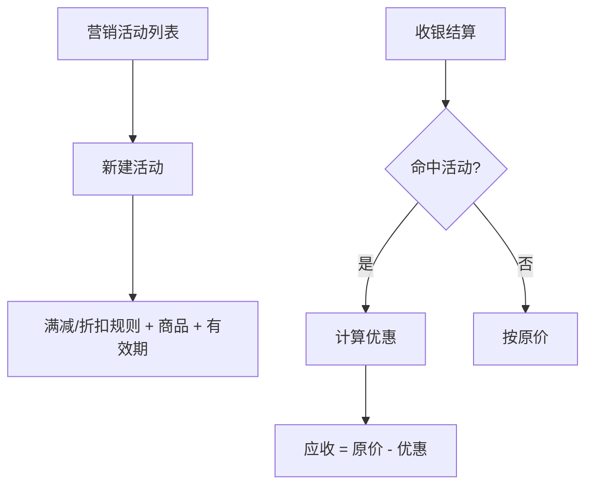

# 功能开发文档 · 34·营销中心

> 项目：宠老板复刻 · 里程碑：M5（F-054，P1）
> 作用：营销活动管理（满减/折扣/会员价），收银结算时自动应用营销规则，提升课堂演示的营销闭环。

---

## 1. 功能概述

实现**营销活动**：配置营销规则（满减、折扣、指定商品营销），收银结算时按规则自动计算优惠；本期聚焦基础满减/折扣，做收银深度联动演示。

- 核心产出：营销活动 CRUD、结算优惠计算、营销列表。
- 前置：M3 收银、F-023 参数、M5 会员等级(可作满减门槛)。

---

## 2. 营销应用流程



---

## 3. 需求明细

| 编号 | 功能点 | 说明 | 优先级 |
|------|--------|------|--------|
| R-01 | 活动管理 | 满减/折扣/指定商品/有效期 | P1 |
| R-02 | 结算计算 | 命中自动优惠 | P1 |
| R-03 | 活动列表 | 启用/停用/状态 | P1 |

---

## 4. 表结构 `marketing_activity`
| 字段 | 类型 | 说明 |
|------|------|------|
| id | bigint PK | 主键 |
| shop_id | bigint | 租户 |
| name | varchar | 活动名 |
| type | tinyint | 1 满减 2 折扣 |
| threshold | decimal | 满减门槛/基础价 |
| discount_value | decimal | 减额或折扣 |
| goods_ids | varchar | 限定商品(空=全部) |
| start_time / end_time | datetime | 有效期 |
| status | tinyint | 1 启用 0 停用 |

---

## 5. 接口设计
- `POST /api/v1/marketing/save` / `page` / `status`。
- 收银结算引用 `calculate` 组件：遍历命中活动取最优优惠（`MarketingCalculator`）。

---

## 6. 前端设计
- `pages/marketing/List.tsx`：活动列表 + 新建表单 + 启停。

---

## 7. 代码落点
```
member-service(或独立 marketing-service)/controller/MarketingController.java
  service/MarketingService.java / mapper/MarketingMapper.java
  calculator/MarketingCalculator.java (供收银结算复用)
frontend/src/pages/marketing/List.tsx
```

---

## 8. 开发任务清单

- [ ] 建表 marketing_activity。
- [ ] 活动 CRUD + 启停。
- [ ] `MarketingCalculator` 结算算优惠。
- [ ] 收银结算接入营销优惠。
- [ ] 前端营销页。
- [ ] 自测：满减/折扣命中正确、优惠不叠加超限。

---

## 9. 验收标准（DoD）

- [ ] 活动可配置并启停，有效期内生效。
- [ ] 收银结算正确应用最优优惠，金额无误。
- [ ] 佣金/对账（营销让利）口径与订单记录一致。