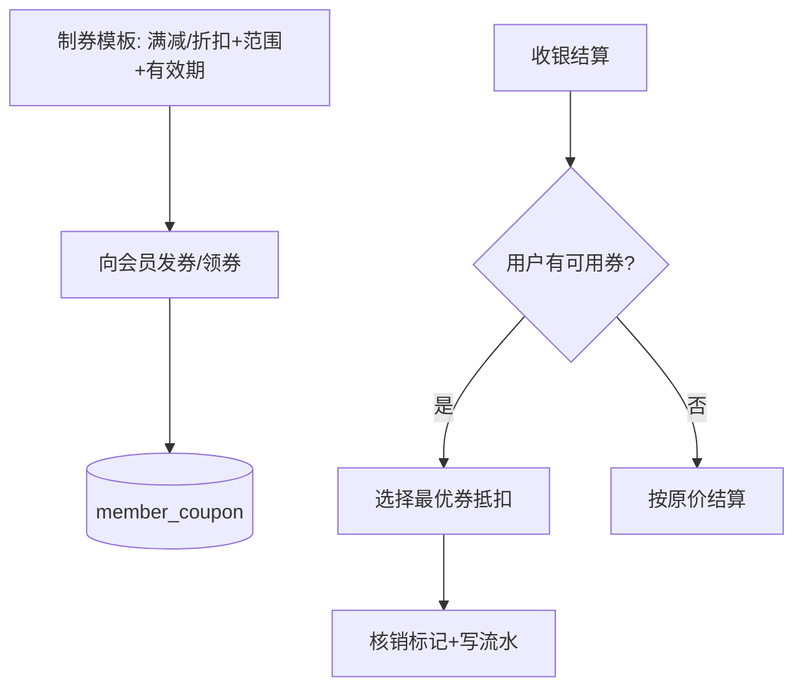

# 功能开发文档 · 35·营销中心（扩展）

> 项目：宠老板复刻 · 里程碑：M6（F-060，P1 · 二期）
> 作用：在 F-054 基础营销之上，扩展卡券（优惠券）、短信营销与会员分群触达，增强课堂营销演示场景。

---

## 1. 功能概述

在「基础满减/折扣」之上扩展**卡券与短信营销**：门店制券、指定会员领用/派发、收银核销；结合会员标签分群做短信触达。本期实现核心卡券闭环。

- 核心产出：优惠券模板、会员发券、收银核销、营销报表联通。
- 前置：F-054 基础营销、F-050 会员、M3 收银、F-023 参数。

---

## 2. 卡券核销流程



---

## 3. 需求明细

| 编号 | 功能点 | 说明 | 优先级 |
|------|--------|------|--------|
| R-01 | 优惠券模板 | 满减/折扣/限定商品/数量/有效期 | P1 |
| R-02 | 发券/领券 | 指定会员发券、门店码领券 | P1 |
| R-03 | 收银核销 | 结算选券抵扣并核销 | P1 |
| R-04 | 券明细 | 已领/已用/过期统计 | P1 |

---

## 4. 表结构

### 4.1 券模板 `coupon_template`
| 字段 | 类型 | 说明 |
|------|------|------|
| id | bigint PK | 主键 |
| shop_id | bigint | 租户 |
| name | varchar | 券名 |
| type | tinyint | 1 满减 2 折扣 |
| threshold | decimal | 满减门槛 |
| discount_value | decimal | 减额/折扣 |
| total_count | int | 发行量 |
| valid_days | int | 有效期 |
| status | tinyint | 启用/停用 |

### 4.2 会员券 `member_coupon`
| 字段 | 类型 | 说明 |
|------|------|------|
| id | bigint PK | 主键 |
| member_id | bigint | 会员 |
| template_id | bigint | 模板 |
| status | tinyint | 1 未用 2 已用 3 过期 |
| consume_time | datetime | 核销时间 |

---

## 5. 接口设计
- `POST /api/v1/marketing/coupon-template/save`：制券。
- `POST /api/v1/marketing/coupon/issue`：向会员发券。
- `POST /api/v1/marketing/coupon/use`：收银核销（防重复核销）。

---

## 6. 前端设计
- `pages/marketing/Coupon.tsx`：券模板列表 + 制券 + 发券 + 核销统计。

---

## 7. 代码落点
```
member-service/controller/CouponController.java
  service/CouponService.java / mapper/CouponTemplateMapper.java / MemberCouponMapper.java
frontend/src/pages/marketing/Coupon.tsx
```

---

## 8. 开发任务清单

- [ ] 建表 coupon_template / member_coupon。
- [ ] 制券 + 发券 + 核销接口。
- [ ] 收银结算接入券抵扣（与 F-054 优惠取最优）。
- [ ] 前端卡券页。
- [ ] 自测：发券入账、核销唯一、过期不可用。

---

## 9. 验收标准（DoD）

- [ ] 券可制、可发，会员即可用。
- [ ] 收银核销正确抵扣且防重复核销，券状态流转正确。