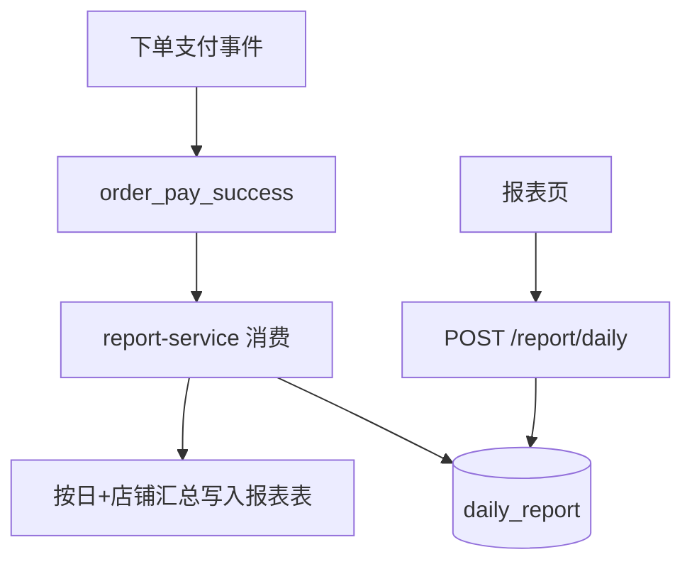

# 功能开发文档 · 36·营业报表

> 项目：宠老板复刻 · 里程碑：M6（F-061，P1 · 二期）
> 作用：按日/月汇总营业数据（销售额、订单量、客单价、退款），驱动看板与统计，采用异步预汇总应对数据量增长。

---

## 1. 功能概述

实现**营业报表**：按日/按店铺维度预汇总营业额、订单数、客单价、退款额，支持按日期区间查询，供看板（F-020）与统计页消费。

- 核心产出：日报/月报汇总表、报表查询、看板指标。
- 前置：M3 订单/支付、M0 基建、RocketMQ（异步预汇总）。

---

## 2. 报表汇总流程（异步）



> 说明：实时看板可先直查订单表，二期引入 RocketMQ 异步预汇总优化大库查询。

---

## 3. 需求明细

| 编号 | 功能点 | 说明 | 优先级 |
|------|--------|------|--------|
| R-01 | 日报汇总 | 销售额/订单量/客单价/退款 | P1 |
| R-02 | 区间查询 | 按起始/结束日期 | P1 |
| R-03 | 看板联动 | 提供看板指标数 | P1 |

---

## 4. 表结构 `daily_report`
| 字段 | 类型 | 说明 |
|------|------|------|
| id | bigint PK | 主键 |
| shop_id | bigint | 租户 |
| report_date | date | 日期 |
| sale_amount | decimal | 销售额 |
| order_count | int | 订单数 |
| refund_amount | decimal | 退款额 |
| avg_order | decimal | 客单价 |
| update_time | datetime | |

---

## 5. 接口设计
- `POST /api/v1/report/daily`：区间查询，返回每日报表列表。
- 汇总逻辑：RocketMQ 消费支付事件 → upsert `daily_report`。

---

## 6. 前端设计
- `pages/report/Daily.tsx`：日期区间 + 表格（含趋势）。

---

## 7. 代码落点
```
report-service/consumer/ReportConsumer.java (RocketMQ)
  service/ReportService.java / mapper/DailyReportMapper.java / controller/ReportController.java
frontend/src/pages/report/Daily.tsx
```

---

## 8. 开发任务清单

- [ ] 建表 daily_report。
- [ ] MQ 消费支付事件预汇总日报。
- [ ] 区间查询接口。
- [ ] 看板指标对接（F-020）。
- [ ] 前端日报页。
- [ ] 自测：支付后日报正确累加、区间查询准确。

---

## 9. 验收标准（DoD）

- [ ] 按日/区间查询销售额、订单量、客单价准确。
- [ ] 异步汇总不丢不重（幂等）。
- [ ] 看板统计卡与日报一致。