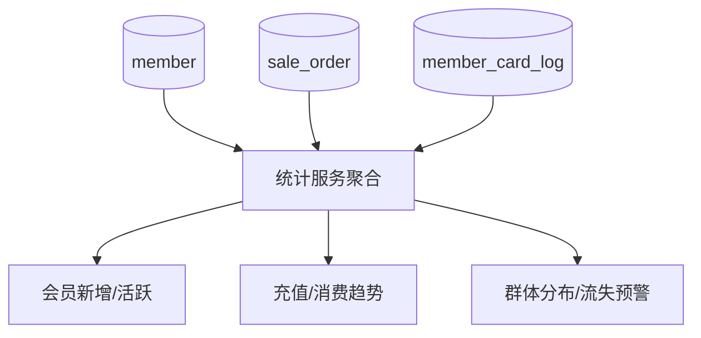

# 功能开发文档 · 37·统计数据

> 项目：宠老板复刻 · 里程碑：M6（F-062，P1 · 二期）
> 作用：会员/门店维度经营统计（新增会员、储值、消费频次、流失预警），为经营决策提供多视角图表。

---

## 1. 功能概述

提供**经营统计**：会员新增/活跃、充值/消费趋势、客群分布（等级/宠物类型）、消喵频次与流失预警等汇总图表数据。

- 核心产出：多口径统计接口 + 图表数据。
- 前置：M5 会员、M3 订单、F-061 日报。

---

## 2. 数据来源



---

## 3. 需求明细

| 编号 | 功能点 | 说明 | 优先级 |
|------|--------|------|--------|
| R-01 | 会员新增/活跃 | 按日新增/活跃会员 | P1 |
| R-02 | 充值消费趋势 | 充值/消费额曲线 | P1 |
| R-03 | 群体分布 | 等级/宠物类型占比 | P1 |
| R-04 | 流失预警 | 长期未消费会员 | P1 |

---

## 4. 接口设计
- `POST /api/v1/report/member-stat`：会员统计（新增/活跃/分布）。
- `POST /api/v1/report/trend`：充值消费趋势。
- `POST /api/v1/report/lost`：流失预警列表。

---

## 5. 前端设计
- `pages/report/Stat.tsx`：图表（ECharts）——新增/活跃折线、群体饼图、趋势柱图。

---

## 6. 代码落点
```
report-service/controller/ReportController.java (+memberStat/trend/lost)
  service/StatService.java
frontend/src/pages/report/Stat.tsx
```

---

## 7. 开发任务清单

- [ ] `StatService`：会员新增/活跃/分布聚合。
- [ ] 趋势与流失预警接口。
- [ ] 前端图表页（ECharts 接入）。
- [ ] 自测：统计口径与明细核对一致。

---

## 8. 验收标准（DoD）

- [ ] 各统计图表数据准确，与明细一致。
- [ ] 大型数据下查询可用（必要时缓存/预汇）。
- [ ] 前端图表交互正常。