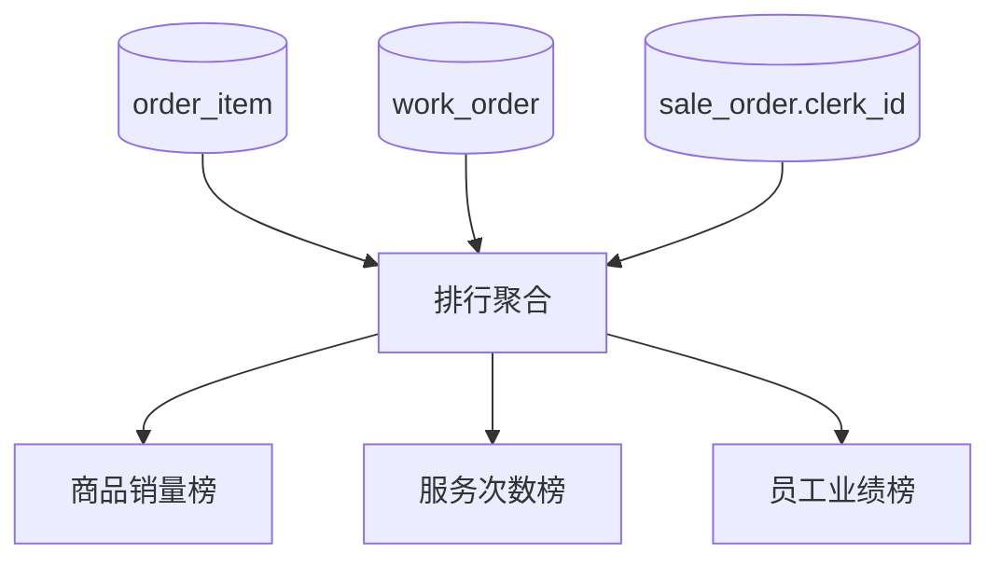

# 功能开发文档 · 38·销售排行

> 项目：宠老板复刻 · 里程碑：M6（F-063，P1 · 二期）
> 作用：商品/服务/员工业绩排行，辅助经营者识别畅销品与高效员工。

---

## 1. 功能概述

按区间维度输出**销售排行**：商品销量/SKU 排行、服务次数排行、营销活动让利排行、员工业绩排行。

- 核心产出：多维度排行接口 + 排行页。
- 前置：M3 订单明细、M4 商品/服务、F-032 员工业绩。

---

## 2. 数据来源



---

## 3. 需求明细

| 编号 | 功能点 | 说明 | 优先级 |
|------|--------|------|--------|
| R-01 | 商品销售排行 | 销量/销售额 TopN | P1 |
| R-02 | 服务排行 | 服务次数 TopN | P1 |
| R-03 | 员工业绩排行 | 销售/服务业绩 | P1 |

---

## 4. 接口设计
- `POST /api/v1/report/sales-rank`：区间的商品/服务/员工排行列表（type 区分）。

---

## 5. 前端设计
- `pages/report/Rank.tsx`：区间选择 + Tab 切换各排行（ECharts 条形图）。

---

## 6. 代码落点
```
report-service/controller/ReportController.java (+salesRank)
  service/RankService.java
frontend/src/pages/report/Rank.tsx
```

---

## 7. 开发任务清单

- [ ] `RankService`：商品/服务/员工排行聚合。
- [ ] 排行接口。
- [ ] 前端排行页。
- [ ] 自测：TopN 排序与金额正确。

---

## 8. 验收标准（DoD）

- [ ] 各维度排行 TopN 排序与汇总正确。
- [ ] 前端图表与明细对账一致。