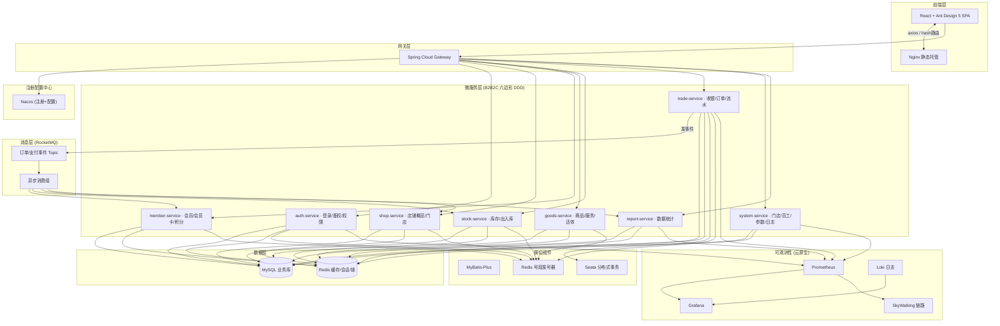
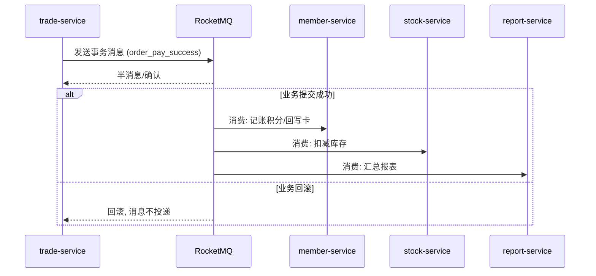
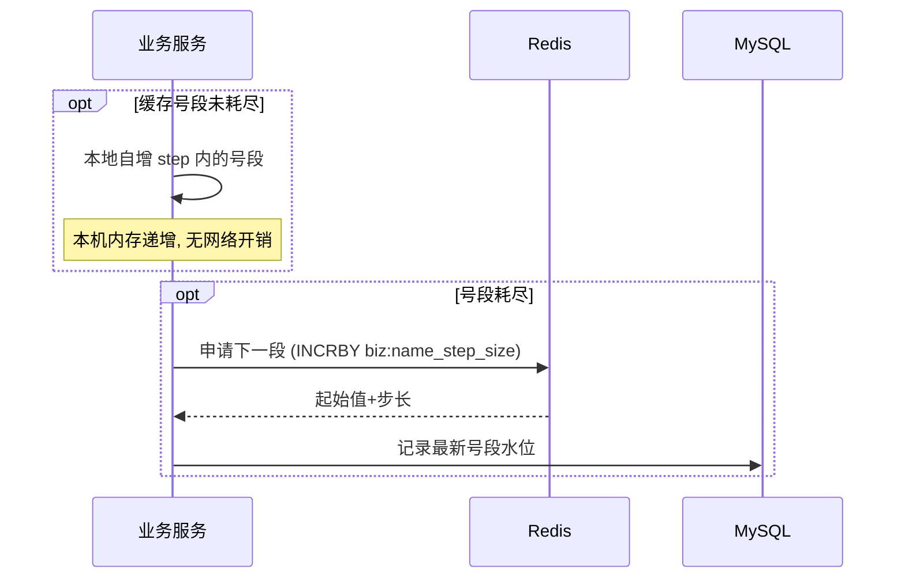
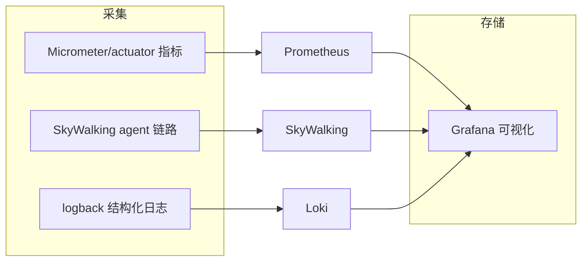
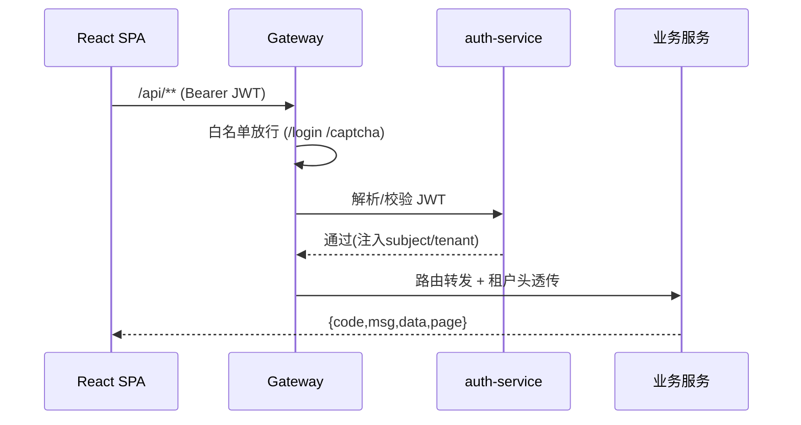
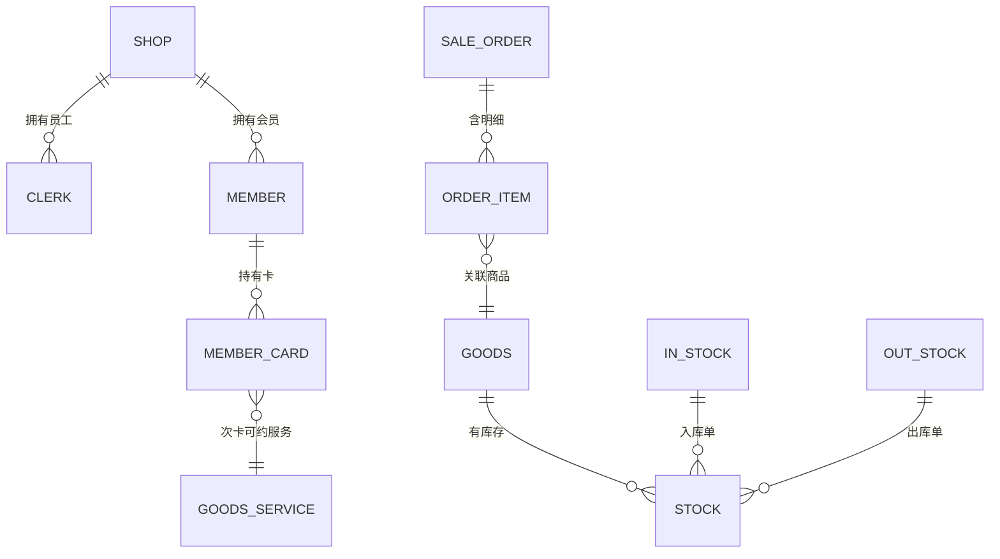
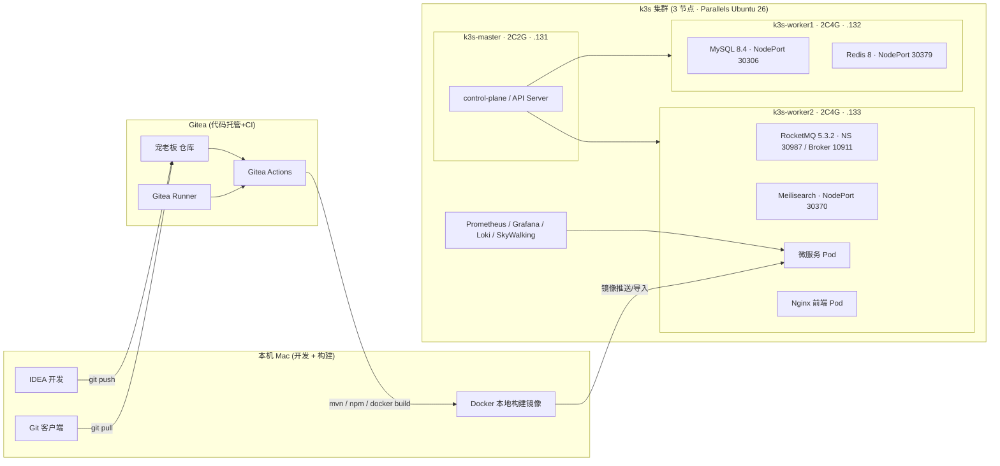
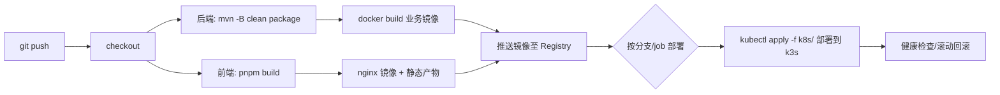

# 宠老板 复刻规划文档

> 原系统：`v70.chonglaoban.cn`（宠老板 · 宠物店全链路 SaaS 经营管理 · PC 后台）
> 复刻技术栈：Java 25 + Spring Boot 4 + Spring Cloud Alibaba + MyBatis-Plus + MySQL + Redis
> 前端：React + Ant Design 5
> 场景：课堂教学项目（无资源约束）· 部署环境为本地 k3s 三机集群（Parallels Ubuntu 26 VM）
> 构建流水线：Gitea（代码托管 + CI/CD）· Mac 本地构建镜像 + 推送/导入至 k3s 集群运行

---

## 1. 原系统勘察结论

### 1.1 技术特征
| 层 | 原系统 | 说明 |
|----|--------|------|
| 前端 | Vue SPA（`#/` hash 路由）+ Ant Design | 多语言(zh-cn)、记住密码、+86 手机登录 |
| 后端 | PHP ThinkPHP | 接口 `POST /{Controller}/{action}`，multipart/form-data |
| 认证 | token 公参 + sign 签名 + timestamp | 返回 `{result, msg, data, page_info, desc}` |
| 登录 | 手机号 + 密码 + 记住密码 | 支持注册、忘记密码 |

### 1.2 公参约定（原系统 Request 抓包）
```
token          (登录后下发，pc_ 前缀)
sys_type       pc
lang           zh-cn
act            业务动作区分
version_name   6.16.0
timestamp      秒级时间戳
sign           MD5(参数拼接+盐) 大写
```
响应：`{"result":0,"msg":"请求成功","data":[...],"page_info":null,"desc":"","extend_field":null,"extra_code":""}`

### 1.3 前端技术栈确认
- 路由目录：`survey` 店铺概况 / `cashier` 收银台 / `order` 订单 / `orderservice` 订单服务 / `commodity` 商品 / `service` 服务 / `living` 活体 / `stock` 库存 / `memberstore` 会员 / `membercard` 会员卡 / `integral` 积分 / `market` 营销 / `statisreport` 数据统计 / `shopstore` 基础配置 / 医疗 (`registerList` 挂号 / `caseManageList` 病历 / `prescribeList` 处方 / `assayList` 检验 / `imageList` 影像) 等。

---

## 2. 复刻目标（首期·核心经营闭环优先）

以「登录鉴权 → 店铺概况 → 收银台 → 商品/服务 → 库存 → 会员 → 订单」为核心主链路，先交付可运行的微服务闭环，二期再扩展营销/商城/新零售/医疗。

**首期范围（P0/P1）：**
| 模块 | 路由 | 归属服务 | 优先级 |
|------|------|----------|--------|
| 登录/鉴权/多语言 | login | auth-service | P0 |
| 店铺概况看板 | survey | shop-service / report-service | P0 |
| 收银台 | cashier | trade-service | P0 |
| 订单管理 | order / orderservice | trade-service | P0 |
| 商品 & 服务管理 | commodity / service | goods-service | P0 |
| 库存管理 | stock / instock / outstock | stock-service | P1 |
| 会员 & 会员卡/次卡/积分 | memberstore / membercard | member-service | P1 |
| 基础配置（门店/员工/参数） | shopstore / clerkstore | system-service | P1 |

---

## 3. 目标架构



> 图中 edge label 一律加引号、避免 `#`/`<br/>` 等 Mermaid 保留字符，以保证渲染稳定。

### 3.1 消息层设计（RocketMQ）



### 3.2 分布式 ID（Redis 号段模式）

订单、会员、商品等在多服务间共享主键，采用 **Redis 号段发号器**（改进自 Leaf-segment），避免每次自增直连 DB：



- **号段表**：`id_segment`（biz_type、max_id、step、version），每类业务独立号段，互不干扰。
- **缓存策略**：内存号段耗尽前刷新（如剩余 20% 时异步预取下一段），避免高峰阻塞。
- **单调性**：单 JVM 内有序递增；跨实例仅保证整体唯一、趋势递增，满足索引友好。
- **落库时机**：每段写回 DB 水位，重启后从 DB 续号，保证不重复；DB + Redis 双保障。

### 3.3 可观测性（云原生三支柱）



- **Metrics**：Spring Boot Actuator + Micrometer 暴露 `/actuator/prometheus`，Prometheus 抓取、Grafana 大盘（QPS/延迟/TPS/GC/连接池）。
- **链路追踪**：SkyWalking agent 随镜像注入，跨服务（网关→auth→trade→MQ 消费）全链路追踪。
- **日志**：logback JSON 结构化 + Loki 聚合，按 traceId 关联日志与调用链。
- **告警**：预留 Alertmanager 规则（服务不可用/延迟超阈值/队列堆积）。

### 3.4 接口风格
原系统为 PHP 风格 `POST /ReShop/index` + `act` 参数区分动作。复刻统一为 **RESTful**：
```
POST /api/v1/shop/survey         查询店铺概况
POST /api/v1/trade/order/page     订单分页
POST /api/v1/member/info          会员详情
```
统一请求上下文头：`Authorization: Bearer {jwt}`，业务参数 JSON。响应统一封装：
```
{ code:0, msg:"成功", data:..., page:{ page_num, page_size, total } }
```

---

## 4. 网关与公共组件层


- 统一鉴权：DRouter/JWT 过滤器，多语言上下文，租户隔离（`shop_id`/`chain_group_id`）。
- 统一异常、统一响应、全局幂等、参数校验（Validation）。
- 分布式事务：Seata（收银跨库存/会员/订单时使用）。

---

## 5. 核心业务模型（首期 ER 关系）


核心表（首期）：`shop`、`clerk`、`member`、`member_card`、`card_rule`、`goods`、`service`、`stock`、`instock`、`outstock`、`sale_order`、`order_item`、`payment`、`cashbook`、`integral_log`、`sys_param`、`operation_log`。

---

## 6. 分期里程碑

### 里程碑 M0：脚手架（本期启动即可执行）
- 后端：多模块 Maven 工程（SpringBoot4 + Java25 + MP 3.5.17 + SCA 2025.1.1 + Knife4j + JJWT + Lombok 1.18.38），`auth/shop/member/goods/stock/trade/system/report` 服务拆分，Nacos + Gateway。
- 中间件：RocketMQ（异步事件：订单支付成功→积分/库存/报表），Seata（收银跨服务强一致），Redis 号段发号器（公共组件）。
- 前端：React + Vite + Antd 5 + React Router + Axios 拦截器 + Zustand，登录页/布局/路由骨架。
- 基建：Gitea（代码仓库 + CI runner）、k3s 集群部署 Nacos/MySQL/Redis/RocketMQ/Seata/Prometheus/Grafana/Loki/SkyWalking（NodePort + nodeSelector 调度）。
- 公共组件：统一响应/异常/租户上下文 + Redis 号段发号器 + traceId 日志。
- CI：Gitea Actions 流水线（Java 构建 + 镜像推送 + kubectl 部署到 k3s 集群）。

### 里程碑 M1：登录鉴权闭环（P0）
- 手机号+密码登录、注册、忘记密码、JWT 签发/刷新、多语言(zh-cn)、租户上下文。
- 前端登录页、记住密码、路由守卫。

### 里程碑 M2：店铺概况 + 基础配置（P0/P1）
- 店铺概况看板：今日订单/会员/提醒/预约、待付款/待发货/待退款、库存不足、公告。
- 门店、员工、系统参数管理。

### 里程碑 M3：收银台 + 订单（P0，核心）
- 收银台选品、会员选择、折扣/收款、支付流水落账（Seata）。
- 订单列表/详情、订单服务（服务/寄养子模块预留）。

### 里程碑 M4：商品服务 + 库存（P0/P1）
- 商品/SKU、服务项目、活体；入库/出库/库存查询。

### 里程碑 M5：会员中心（P1）
- 会员档案、会员卡、次卡、积分流转。

---

## 7. 版本控制与部署流水线（Gitea + k3s）

### 7.1 基础设施拓扑



> 节点规划：master 仅跑控制面（2C2G，不承载业务负载）；MySQL/Redis 落 worker1；RocketMQ/Meilisearch 及业务微服务落 worker2。通过 `nodeSelector: app-host=w1/w2` 精确调度。

### 7.2 CI/CD 流程（Gitea Actions + kubectl）



- 触发方式：`main` 分支 push 自动部署；`feature/*` 分支仅构建不部署。
- 产物：业务镜像推送至内网 Registry，k3s 集群通过 `kubectl apply` 滚动更新 Deployment。
- 镜像加速：统一使用 `docker.1ms.run/<repo>:<tag>` 前缀，规避大陆网络 Docker Hub 不稳定。
- 暴露方式：中间件用 NodePort（30306/30379/30370 等），业务服务走 Gateway Service。
- 可观测性：全栈三支柱（Metrics/链路/日志）随服务注入，Prometheus + Grafana + Loki + SkyWalking 统一监控。

---

## 8. 首批技术待办

- [ ] 搭建 Gitea 服务与 Gitea Runner，创建宠老板项目仓库。
- [ ] 依据里程碑 M0 生成多模块脚手架（spring-boot4 @EnableAutoConfiguration / DDD 六边形分层）。
- [ ] 搭建 k3s 集群基建（Nacos / MySQL / Redis / RocketMQ / Seata / 可观测组件，NodePort + nodeSelector 调度）。
- [ ] 公共组件：Redis 号段发号器 + 统一响应/异常/租户上下文 + traceId 日志。
- [ ] `auth-service` 登录鉴权 + JWT，打通前端登录页。
- [ ] `shop-service` 店铺概况看板数据聚合。
- [ ] 可观测接入：actuator/prometheus、SkyWalking agent、JSON 日志（Loki）。